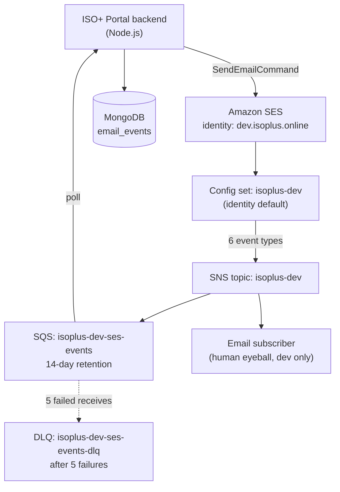
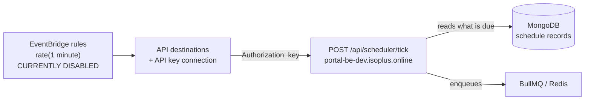

# ISO+ Portal — Email and Scheduling Developer Guide

**Environment:** dev
**Region:** `ap-southeast-2` (Sydney)
**AWS Account:** `<AWS_ACCOUNT_ID>`
**Last verified:** 18 August 2026

---

## 1. Read this first

Three things will cost you a day each if you skip them.

**This is a shared AWS account.** Production sends real client email from the same account, the same region, and the same suppression list. There is no separate dev account. Treat every action as if it can touch production, because some of them can.

**There is a recipient allowlist on the dev credentials.** Sending to an address outside it fails with `AccessDenied`, not a bounce. This is deliberate. See section 5.

**Do not build an HTTPS webhook for delivery events.** That was the original design and it has been replaced by SQS. See section 7.

---

## 2. Architecture



The scheduler is a separate path and shares nothing with the above:



---

## 3. What exists

| Resource | Identifier |
|---|---|
| SES domain identity | `dev.isoplus.online` |
| DKIM | Enabled, RSA 2048, status `SUCCESS` |
| Custom MAIL FROM | `mail.dev.isoplus.online`, status `SUCCESS` |
| Configuration set | `isoplus-dev`, set as **identity default** |
| TLS policy | `REQUIRE` |
| Event destination | SNS, 6 event types |
| SNS events topic | `arn:aws:sns:ap-southeast-2:<AWS_ACCOUNT_ID>:isoplus-dev` |
| SNS alerts topic | `arn:aws:sns:ap-southeast-2:<AWS_ACCOUNT_ID>:isoplus-dev-alerts` |
| SQS events queue | `https://sqs.ap-southeast-2.amazonaws.com/<AWS_ACCOUNT_ID>/isoplus-dev-ses-events` |
| SQS DLQ | `https://sqs.ap-southeast-2.amazonaws.com/<AWS_ACCOUNT_ID>/isoplus-dev-ses-events-dlq` |
| IAM user | `isoplus-app-dev` |
| IAM policy | `isoplus-app-dev-policy` (v5) |

Account sending status: **production access granted**, not sandbox. Quota 50,000 per 24h, 14/sec.

---

## 4. Sending email

### Environment variables

```bash
AWS_REGION=ap-southeast-2
AWS_ACCESS_KEY_ID=<the isoplus-app-dev key>
AWS_SECRET_ACCESS_KEY=<secret>
MAIL_FROM=noreply@dev.isoplus.online
SES_EVENTS_QUEUE_URL=https://sqs.ap-southeast-2.amazonaws.com/<AWS_ACCOUNT_ID>/isoplus-dev-ses-events
```

Use the same access key the app already uses for S3. No new IAM user, no SMTP credentials.

### Code

```js
import { SESv2Client, SendEmailCommand } from '@aws-sdk/client-sesv2';

const ses = new SESv2Client({ region: process.env.AWS_REGION });

export async function sendEmail({ to, subject, html, text }) {
  const command = new SendEmailCommand({
    FromEmailAddress: process.env.MAIL_FROM,
    Destination: { ToAddresses: Array.isArray(to) ? to : [to] },
    Content: {
      Simple: {
        Subject: { Data: subject, Charset: 'UTF-8' },
        Body: {
          Html: { Data: html, Charset: 'UTF-8' },
          ...(text && { Text: { Data: text, Charset: 'UTF-8' } }),
        },
      },
    },
  });

  const result = await ses.send(command);
  return result.MessageId;
}
```

### Why SESv2 and not SESv1

Use `@aws-sdk/client-sesv2`. Both work, but v2 is the current API and it correctly populates the `ses:Recipients` IAM condition key that the allowlist depends on. This was verified at runtime, not assumed.

### From addresses

Because the identity is a **domain**, any address on `dev.isoplus.online` works without individual verification. Default to `noreply@dev.isoplus.online`. If you need a reply-to that reaches a person, set `ReplyToAddresses` rather than changing the From.

### Configuration set

Do not pass `ConfigurationSetName`. The config set is attached to the identity as its default, so it applies automatically to every send. This is deliberate: it makes it impossible to accidentally send an email that is not tracked.

Passing it explicitly also works and produces identical behaviour. Only do that if your code needs to be explicit for readability.

### Save the MessageId

`SendEmailCommand` returns a `MessageId`. **Persist it against whatever business record triggered the send.** Every delivery and bounce event arriving on the queue is keyed by that ID and there is no other way to correlate an event back to an invoice or statement.

---

## 5. The recipient allowlist

The dev IAM policy carries this condition on `ses:SendEmail` and `ses:SendRawEmail`:

```json
"Condition": {
  "ForAllValues:StringLike": {
    "ses:Recipients": [
      "*@isoconsultingservices.com.au",
      "*@isoplus.online",
      "*@simulator.amazonses.com"
    ]
  }
}
```

Sending anywhere else produces:

```
AccessDeniedException: User: arn:aws:iam::<AWS_ACCOUNT_ID>:user/isoplus-app-dev
is not authorized to perform: ses:SendEmail
```

### Things to know about this

**It is an API-level rejection, not a bounce.** The call throws. No message is sent, no event appears on the queue, nothing hits the suppression list. Handle it as a code or configuration error, not a delivery failure.

**`ForAllValues` means every recipient must match.** One bad address in a `ToAddresses` array fails the entire send, including the valid recipients. If you batch, validate first.

**Subdomains do not match.** `*@isoplus.online` matches `someone@isoplus.online` but **not** `someone@dev.isoplus.online`. If you need to send to a subdomain address, it has to be added explicitly.

**a developer's own domain will not be added.** Decided 18 August 2026. If you were planning to test against `<developer-email>`, use `success@simulator.amazonses.com` instead, or an address at `isoconsultingservices.com.au`. The simulator exercises the identical code path and produces a real Delivery event, so it proves everything a real address would, without the risk of suppressing a client contact.

### Defensive check

Fail fast in your own code so you get a clear error rather than an AWS one:

```js
const ALLOWED = [
  /@isoconsultingservices\.com\.au$/i,
  /@isoplus\.online$/i,
  /@simulator\.amazonses\.com$/i,
];

function assertAllowed(recipients) {
  if (process.env.NODE_ENV === 'production') return;
  const bad = recipients.filter(r => !ALLOWED.some(re => re.test(r)));
  if (bad.length) {
    throw new Error(`Recipients blocked by dev allowlist: ${bad.join(', ')}`);
  }
}
```

---

## 6. Testing

### Use the simulator

SES provides addresses that produce a given outcome without sending anything to a real mailbox. They are on the allowlist already.

| Address | Result |
|---|---|
| `success@simulator.amazonses.com` | Delivery event |
| `bounce@simulator.amazonses.com` | Hard bounce event |
| `complaint@simulator.amazonses.com` | Complaint event |
| `suppressionlist@simulator.amazonses.com` | Simulates an already-suppressed address |

These exercise the full pipeline: SES to SNS to SQS to your consumer. They do **not** add anything to the suppression list. Verified.

### The suppression list is shared with production

This is the single most damaging mistake available to you.

The account-level suppression list currently holds **72 addresses**, including real client contacts at `whitech.net`, `addsum.com.au` and `sinogem.com.au`. It is account-wide. An address suppressed by a dev test is suppressed for production too, and production will then silently stop delivering to that person.

Never send test mail to:
- a real client address
- a made-up address at a real domain (`asdf@gmail.com` bounces and gets suppressed)
- your own address at a domain you do not control

The list already contains entries like `AAA@gmail.com`, `test@x.com` and `BBB@gmail.com`. Those are exactly this mistake, made previously.

Check the list before assuming a delivery problem is your code:

```bash
aws sesv2 get-suppressed-destination --email-address someone@example.com --region ap-southeast-2
```

---

## 7. Consuming delivery and bounce events

### Do not build a webhook

The original spec had an HTTPS endpoint at `/api/email/events`. That is superseded. Do not build it.

SQS is less work: no public endpoint, no SNS subscription confirmation handshake, no signature verification, no attack surface. If your consumer is down, messages wait up to 14 days rather than being lost.

### Consumer

```bash
npm install sqs-consumer @aws-sdk/client-sqs
```

```js
import { Consumer } from 'sqs-consumer';
import { SQSClient } from '@aws-sdk/client-sqs';

const app = Consumer.create({
  queueUrl: process.env.SES_EVENTS_QUEUE_URL,
  sqs: new SQSClient({ region: process.env.AWS_REGION }),
  batchSize: 10,
  waitTimeSeconds: 20,     // long polling
  visibilityTimeout: 30,
  heartbeatInterval: 10,   // extends the lock while still working
  handleMessage: async (message) => {
    const event = JSON.parse(message.Body);
    await recordSesEvent(event);
  },
});

app.on('error', (err) => logger.error({ err }, 'sqs error'));
app.on('processing_error', (err) => logger.error({ err }, 'handler threw'));
app.on('timeout_error', (err) => logger.error({ err }, 'handler too slow'));

app.start();
process.on('SIGTERM', () => app.stop());
```

### How it actually works

It polls. There is no webhook and nothing needs to be publicly reachable. `waitTimeSeconds: 20` means each poll holds the connection open for up to 20 seconds waiting for a message, so an idle queue costs roughly 3 requests per minute rather than thousands.

A message is deleted **only after `handleMessage` resolves**. If your handler throws, or the process dies mid-message, the message becomes visible again after `visibilityTimeout` and is redelivered.

That is the safety property you want, and it is also why the next section is not optional.

### Raw message delivery is on

`RawMessageDelivery` is `true` on the SNS to SQS subscription. `message.Body` is the SES event JSON directly. You do **not** need to unwrap an SNS envelope.

If you see `{"Type":"Notification","MessageId":...,"Message":"{...}"}` then raw delivery has been turned off and something changed in the infrastructure. Flag it rather than adding an unwrap step.

---

## 8. Concurrency and idempotency

Multiple app instances can poll the same queue safely. SQS hands each message to one consumer at a time and hides it for the visibility timeout.

But delivery is **at-least-once**, not exactly-once. You will occasionally process the same event twice: a handler that takes longer than 30 seconds, a pod restart, or an SQS internal retry all cause it.

Make the write idempotent with a unique index.

```js
const key = `${event.mail.messageId}:${event.eventType}:${event.mail.destination[0]}`;
```

```js
// MongoDB: unique index on eventKey
await db.collection('email_events').createIndex({ eventKey: 1 }, { unique: true });

async function recordSesEvent(event) {
  const eventKey = `${event.mail.messageId}:${event.eventType}:${event.mail.destination[0]}`;
  try {
    await db.collection('email_events').insertOne({
      eventKey,
      messageId: event.mail.messageId,
      eventType: event.eventType,
      recipient: event.mail.destination[0],
      timestamp: new Date(event.mail.timestamp),
      raw: event,
      receivedAt: new Date(),
    });
  } catch (err) {
    if (err.code === 11000) return;   // already processed, not an error
    throw err;
  }
}
```

Swallowing the duplicate-key error is the whole trick. Anything else must throw.

### Do not swallow other errors

```js
// WRONG - the message is deleted and the event is gone forever
handleMessage: async (message) => {
  try {
    await recordSesEvent(JSON.parse(message.Body));
  } catch (err) {
    logger.error(err);   // silently loses the event
  }
}
```

Let it throw. Redelivery is the recovery mechanism, and after 5 failures the message lands in the DLQ where it can be inspected and replayed.

---

## 9. Protecting against mass DLQ migration

If a bug makes your handler throw on *every* message, all of them fail 5 times and move to the DLQ. The queue drains into the DLQ and you have to redrive the lot.

A circuit breaker stops that. After a run of consecutive failures, stop consuming so messages stay safely on the main queue while someone investigates.

```js
let consecutiveFailures = 0;

app.on('processing_error', (err) => {
  logger.error({ err }, 'handler threw');
  if (++consecutiveFailures >= 10) {
    logger.fatal('10 consecutive failures, stopping consumer');
    app.stop();
    alertOps('SES event consumer halted after 10 consecutive failures');
  }
});

app.on('message_processed', () => { consecutiveFailures = 0; });
```

Stopping the consumer will trip the `isoplus-dev-ses-events-stalled` alarm after about 15 minutes, which is the intended outcome. A stalled queue that someone gets paged about beats a silently drained one.

---

## 10. Event payload reference

All events share a `mail` object and add an event-specific block.

**Delivery**
```json
{
  "eventType": "Delivery",
  "mail": {
    "timestamp": "2026-08-18T03:15:22.000Z",
    "messageId": "0100019...",
    "source": "noreply@dev.isoplus.online",
    "destination": ["success@simulator.amazonses.com"]
  },
  "delivery": {
    "timestamp": "2026-08-18T03:15:24.100Z",
    "processingTimeMillis": 2100,
    "recipients": ["success@simulator.amazonses.com"],
    "smtpResponse": "250 2.6.0 Message received"
  }
}
```

**Bounce** — the one that matters
```json
{
  "eventType": "Bounce",
  "mail": { "messageId": "0100019...", "destination": ["bounce@simulator.amazonses.com"] },
  "bounce": {
    "bounceType": "Permanent",
    "bounceSubType": "General",
    "bouncedRecipients": [
      { "emailAddress": "bounce@simulator.amazonses.com",
        "action": "failed",
        "status": "5.1.1",
        "diagnosticCode": "smtp; 550 5.1.1 user unknown" }
    ],
    "timestamp": "2026-08-18T03:15:24.000Z"
  }
}
```

`bounceType` is the field to branch on:

| bounceType | Meaning | Action |
|---|---|---|
| `Permanent` | Address does not exist | Mark invalid, stop sending, alert account manager |
| `Transient` | Mailbox full, server down | Safe to retry later |
| `Undetermined` | Unclear | Treat as transient, watch for repeats |

A `Permanent` bounce adds the address to the account suppression list automatically.

**Complaint** — recipient pressed "spam". Treat as permanent and stop sending immediately, regardless of business need. Complaints damage the sending reputation for every application in the account.

**Other event types you will receive:** `DeliveryDelay` (still trying, no action), `Reject` (SES refused it, usually a virus or malformed content), `RenderingFailure` (template variable missing).

---

## 11. The scheduler

The endpoint is **deployed and authenticating**. Both EventBridge rules remain `DISABLED`, so nothing calls it on a schedule yet.

| Rule | Schedule | Target | State |
|---|---|---|---|
| `isoplus-dev-scheduler-invoice` | `rate(1 minute)` | `POST https://portal-be-dev.isoplus.online/api/scheduler/tick` | DISABLED |
| `isoplus-dev-scheduler-statement` | `rate(1 minute)` | same endpoint | DISABLED |

### Contract

- Method `POST`, no body required
- Header `Authorization: <key>` — the **bare key**, no `Bearer` prefix
- Two separate keys: `SCHEDULER_API_KEY_INVOICE` and `SCHEDULER_API_KEY_STATEMENT`
- Rate limit 10/sec at the API destination

### `AUTOMATION_ENABLED`

An environment variable on the backend that gates whether a tick does any work. With it `false` the endpoint still authenticates and responds, but nothing is generated or sent. Held-back work is reported rather than discarded, so nothing is lost while it is off.

It is a deliberate kill switch. Set it to `false` to stop generation without touching the EventBridge rules or redeploying.

### `bypassEmail`

An optional body parameter that redirects the recipient for that tick only. Added so a deployment can be verified without emailing a participant's real billing contact.

```json
{ "bypassEmail": "you@example.com" }
```

Accepts a comma-separated string or an array. Everything else runs untouched: same selection, same generation, same composition, same attachments. Only the recipient changes.

**Use it for every manual tick.** Without it the recipient is resolved from the profile's Billing Email, so a manual test sends a real document to a real contact. The dev recipient allowlist blocks delivery outside three domains, but a billing contact that happens to sit inside those domains will receive it.

### Response

```json
{ "claimed": 0, "dispatched": 0, "failed": 0, "heldBack": 1, "capped": false }
```

| Field | Meaning |
|---|---|
| `claimed` | Schedules picked up for processing by this tick |
| `dispatched` | Documents generated and sent |
| `failed` | Errors during processing |
| `heldBack` | Due, but blocked — normally because `AUTOMATION_ENABLED` is `false` |
| `capped` | Whether a batch limit was reached, so more work remains |

Read this rather than assuming a 200 means work happened. A 200 with `heldBack: 1` means the endpoint is healthy and something is waiting, which is exactly what you want to see before enabling automation.

Your endpoint must:

1. **Return 2xx quickly.** EventBridge treats non-2xx as failure and retries. Do the work asynchronously, respond immediately.
2. **Be idempotent per billing period.** A tick that fires twice must not issue two invoices. Key on the billing period, not on the tick.
3. **Be safe to miss.** Because the DB holds what is due and issuance is idempotent, a missed tick self-heals on the next one. Do not build catch-up logic that assumes every tick arrived.
4. **Constant-time compare the key.** Do not use `===` on the auth header.

### Enabling

Do not enable the rules yourself. Confirm with the product owner once the API is deployed and the keys are set, since an enabled rule against a missing endpoint generates failed invocations every minute.

---

## 12. Must do

- Persist the `MessageId` from every send, keyed to the business record
- Use `@aws-sdk/client-sesv2`
- Test with `@simulator.amazonses.com` addresses only
- Put a unique index on the event key and swallow only duplicate-key errors
- Let handler errors throw
- Add the circuit breaker before going anywhere near production
- Handle `SIGTERM` with `app.stop()` so in-flight messages finish

## 13. Don't

- Don't send test mail to real or invented addresses at real domains
- Don't build the HTTPS webhook at `/api/email/events`
- Don't catch and log errors inside `handleMessage` without rethrowing
- Don't delete messages manually
- Don't assume one recipient failing the allowlist only affects that recipient
- Don't unwrap an SNS envelope, raw delivery is on
- Don't enable the EventBridge rules without checking first
- Don't hardcode the config set name in a way that can drift from the identity default

---

## 14. Local development

The queue is shared. If two developers run consumers locally, they will steal each other's messages, because SQS delivers each message to exactly one consumer.

Options, in order of preference:

1. **Don't run a consumer locally.** Send test emails, then read the queue manually when you need to see an event.
2. **Coordinate.** Only one person consumes at a time.
3. **Ask for a personal queue.** Cheap to add as a second SNS subscription if it becomes a real problem.

Read a message without consuming it:

```bash
aws sqs receive-message --queue-url https://sqs.ap-southeast-2.amazonaws.com/<AWS_ACCOUNT_ID>/isoplus-dev-ses-events --max-number-of-messages 1 --wait-time-seconds 5 --visibility-timeout 0 --region ap-southeast-2
```

`--visibility-timeout 0` returns it to the queue immediately so a real consumer still gets it.

---

## 15. Open items

| Item | Owner | Status |
|---|---|---|
| The original IAM access key (id in the password manager) (created 2025-03-19) pending rotation | the product owner | Deferred |
| EventBridge rules disabled until API deployed | Dev team | Blocked on deployment |
| Outbound mail archiving removed 18 Aug 2026. Confirm no NDIS record-keeping requirement depends on it | the product owner | Confirm |
