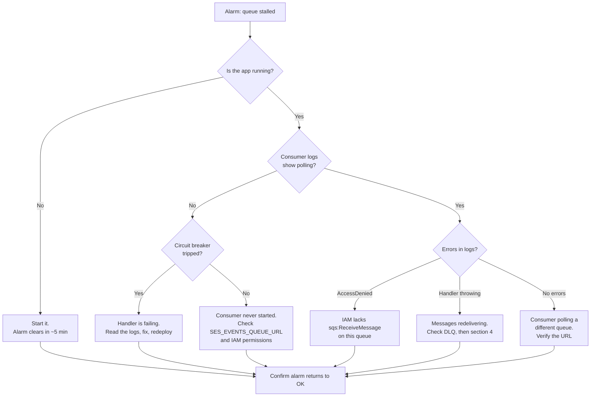
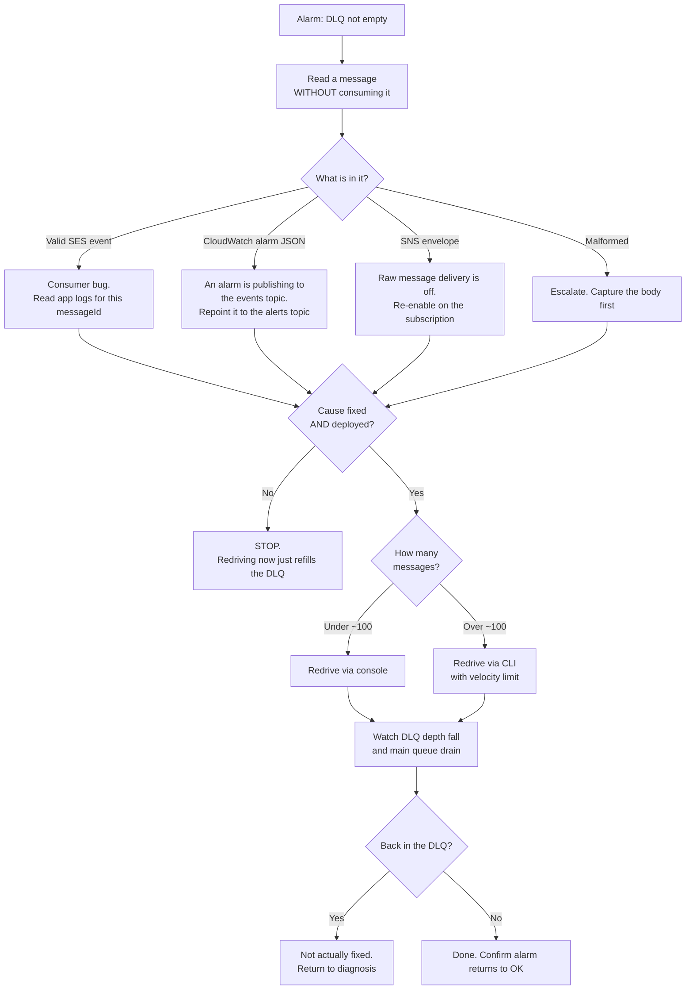
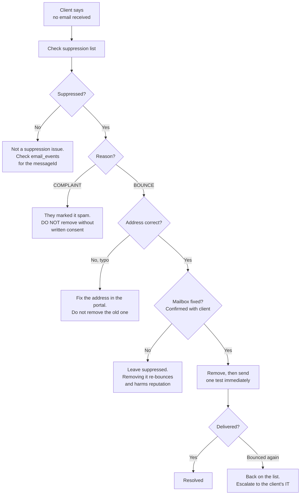
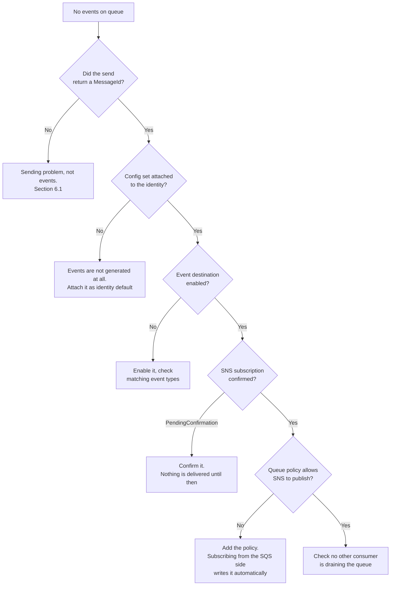
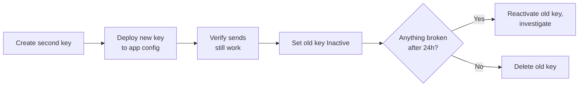

# ISO+ Portal — Email Operations SOP and Troubleshooting

**Region:** `ap-southeast-2` (Sydney)
**AWS Account:** `<AWS_ACCOUNT_ID>`
**Last updated:** 18 August 2026

---

## 1. Before you touch anything

**This account is shared.** Dev, UAT and production all send from account `<AWS_ACCOUNT_ID>` in `ap-southeast-2`. Some resources are shared outright, most importantly the **account-level suppression list**. An action taken while debugging dev can stop production email reaching a client.

Confirm which environment you are in before running any command:

| Environment | Prefix | Sending domain |
|---|---|---|
| dev | `isoplus-dev-*` | `dev.isoplus.online` |
| UAT | `isoplus-uat-*` | `uat.isoplus.online` |
| production | `isoplus-prod-*` | `isoplus.online` |

Environment variables used throughout this document:

```bash
export AWS_REGION=ap-southeast-2
export ENV=dev
export QUEUE_URL=https://sqs.ap-southeast-2.amazonaws.com/<AWS_ACCOUNT_ID>/isoplus-${ENV}-ses-events
export DLQ_URL=https://sqs.ap-southeast-2.amazonaws.com/<AWS_ACCOUNT_ID>/isoplus-${ENV}-ses-events-dlq
```

---

## 2. Health check

Run this when something feels wrong, and after any deployment that touches email.

```bash
echo "== Account =="
aws sesv2 get-account --query "{Prod:ProductionAccessEnabled,Sending:SendingEnabled,Enforcement:EnforcementStatus,Sent24h:SendQuota.SentLast24Hours,Quota:SendQuota.Max24HourSend}" --output table

echo "== Identity =="
aws sesv2 get-email-identity --email-identity ${ENV}.isoplus.online --query "{Verified:VerifiedForSendingStatus,Dkim:DkimAttributes.Status,MailFrom:MailFromAttributes.MailFromDomainStatus,ConfigSet:ConfigurationSetName}" --output table

echo "== Queue depth =="
aws sqs get-queue-attributes --queue-url $QUEUE_URL --attribute-names ApproximateNumberOfMessages ApproximateNumberOfMessagesNotVisible --output table

echo "== DLQ depth =="
aws sqs get-queue-attributes --queue-url $DLQ_URL --attribute-names ApproximateNumberOfMessages --output table

echo "== Alarms =="
aws cloudwatch describe-alarms --alarm-name-prefix isoplus-${ENV} --query "MetricAlarms[].{Name:AlarmName,State:StateValue}" --output table
```

### What healthy looks like

| Check | Healthy | Investigate if |
|---|---|---|
| `EnforcementStatus` | `HEALTHY` | `PROBATION` or `SHUTDOWN` — see 6.4 |
| `SendingEnabled` | `true` | `false` — sending is paused account-wide |
| Identity | all `true` / `SUCCESS` | anything else — see 6.1 |
| Queue depth | 0 to low single digits | steadily climbing — consumer is behind or stopped |
| Messages not visible | near 0 | persistently high — handlers are hanging |
| DLQ depth | **0** | anything above 0 — see section 4 |
| Alarms | all `OK` | `ALARM`, or `INSUFFICIENT_DATA` lasting over an hour |

A DLQ that is not empty always means something needs a human. It never clears itself.

---

## 3. Alarm response

### 3.1 `isoplus-*-ses-events-stalled`

**Means:** the oldest message on the queue has been there over 15 minutes. Nothing is consuming.



First three commands:

```bash
aws sqs get-queue-attributes --queue-url $QUEUE_URL --attribute-names ApproximateNumberOfMessages ApproximateAgeOfOldestMessage
```

```bash
aws sqs get-queue-attributes --queue-url $DLQ_URL --attribute-names ApproximateNumberOfMessages
```

```bash
aws sqs receive-message --queue-url $QUEUE_URL --max-number-of-messages 1 --visibility-timeout 0
```

That last one reads a message without consuming it. If it returns a message, the queue is fine and the consumer is the problem.

**Do not** purge the queue to clear the alarm. That destroys delivery and bounce records with no way to recover them.

### 3.2 `isoplus-*-ses-events-dlq-nonempty`

**Means:** at least one message failed five times. Go to section 4.

### 3.3 Reputation alarms (production only)

**Means:** bounce or complaint rate is approaching the level at which AWS pauses sending for the whole account.

This is the most serious alarm in the system. If it reaches enforcement, **every application in the account stops sending**, not just the portal.

Act immediately:

```bash
aws sesv2 get-account --query "{Enforcement:EnforcementStatus,Sending:SendingEnabled,Sent24h:SendQuota.SentLast24Hours}"
```

```bash
aws cloudwatch get-metric-statistics --namespace AWS/SES --metric-name Reputation.BounceRate --start-time $(date -u -d '24 hours ago' +%Y-%m-%dT%H:%M:%SZ) --end-time $(date -u +%Y-%m-%dT%H:%M:%SZ) --period 3600 --statistics Average
```

Then find what is bouncing:

```javascript
db.email_events.aggregate([
  { $match: { eventType: "Bounce", timestamp: { $gte: new Date(Date.now() - 864e5) } } },
  { $group: { _id: "$raw.bounce.bounceType", count: { $sum: 1 } } }
])
```

A sudden spike almost always means a bad recipient list rather than a reputation problem. Stop the offending send first, then clean the data.

---

## 4. DLQ redrive

The procedure asked for explicitly. Read section 4.1 before touching anything.

### 4.1 Do not redrive first

A message is in the DLQ because it failed five times. **Redriving without fixing the cause sends it back to fail five more times.** Diagnose first.



### 4.2 Inspect without consuming

```bash
aws sqs receive-message --queue-url $DLQ_URL --max-number-of-messages 10 --visibility-timeout 0 --attribute-names All --message-attribute-names All
```

`--visibility-timeout 0` returns the message immediately so it stays available.

The `ApproximateReceiveCount` attribute tells you how many times it was tried. Anything at or above 6 confirms it exhausted `maxReceiveCount` on the main queue.

Correlate with the application logs using the `messageId` from the body. That is usually where the actual error is.

### 4.3 Redrive via the console

The button is not where people expect it. It is on the **DLQ's own page**, not the main queue. Selecting the main queue gives you no redrive option at all, which is why it looks missing.

1. SQS console, `ap-southeast-2`
2. Click **`isoplus-dev-ses-events-dlq`** (the DLQ itself, not the main queue)
3. Top right of the queue detail page, in the button row **Edit · Delete · Purge · Send and receive messages · Start DLQ redrive**
4. Click **Start DLQ redrive**
5. Redrive to: **Queue of origin**
6. Velocity: **System optimized** for small batches, **Custom** and a low rate for large ones
7. Confirm with **DLQ redrive**

```
┌─ isoplus-dev-ses-events-dlq ─────────────────────────────────────────────┐
│                                                                          │
│   [Edit] [Delete] [Purge] [Send and receive messages] [Start DLQ redrive] │
│                     ▲                                          ▲         │
│                     │                                          │         │
│              NEVER click this                          this is the one    │
│           (destroys every message)                                        │
└──────────────────────────────────────────────────────────────────────────┘
```

**Purge sits two buttons away from the one you want.** Purge permanently destroys every message in the queue with no confirmation beyond a single dialog and no way back. Slow down when clicking in this row.

### Monitoring a redrive in progress

The queue detail page has a **Dead-letter queue redrive tasks** tab, alongside Queue policies, Monitoring, SNS subscriptions and the rest. It shows each redrive task, its status, and how many messages have moved. Use it rather than repeatedly refreshing queue depth.

If the button is greyed out, the DLQ is missing a redrive allow policy. Fix:

```bash
aws sqs set-queue-attributes --queue-url $DLQ_URL --attributes '{"RedriveAllowPolicy":"{\"redrivePermission\":\"byQueue\",\"sourceQueueArns\":[\"arn:aws:sqs:ap-southeast-2:<AWS_ACCOUNT_ID>:isoplus-dev-ses-events\"]}"}'
```

### 4.4 Redrive via CLI

```bash
aws sqs start-message-move-task --source-arn arn:aws:sqs:ap-southeast-2:<AWS_ACCOUNT_ID>:isoplus-${ENV}-ses-events-dlq --destination-arn arn:aws:sqs:ap-southeast-2:<AWS_ACCOUNT_ID>:isoplus-${ENV}-ses-events --max-number-of-messages-per-second 10
```

Rate limiting matters. Dumping thousands of messages back at once can overwhelm a consumer that has just been fixed.

Monitor:

```bash
aws sqs list-message-move-tasks --source-arn arn:aws:sqs:ap-southeast-2:<AWS_ACCOUNT_ID>:isoplus-${ENV}-ses-events-dlq
```

Cancel if it goes wrong:

```bash
aws sqs cancel-message-move-task --task-handle <handle>
```

### 4.5 When a message is genuinely unprocessable

Some messages will never succeed: a malformed body, or an event whose business record no longer exists.

**Capture before deleting.** Once deleted it is unrecoverable.

```bash
aws sqs receive-message --queue-url $DLQ_URL --max-number-of-messages 10 --visibility-timeout 30 > dlq-capture-$(date +%Y%m%d-%H%M).json
```

Then delete using the receipt handle from that output:

```bash
aws sqs delete-message --queue-url $DLQ_URL --receipt-handle "<handle>"
```

Note the deletion, the reason, and where the capture file lives. In production this is an auditable event.

---

## 5. The suppression list

Account-wide. Shared by dev, UAT and production. Currently **72 addresses**, including real client contacts.

An address here receives nothing from any environment. This is the most common cause of "the client says they never got the invoice".

### Check one address

```bash
aws sesv2 get-suppressed-destination --email-address someone@example.com
```

`NotFoundException` is good news, it means not suppressed.

### List everything

```bash
aws sesv2 list-suppressed-destinations --query "SuppressedDestinationSummaries[].{Email:EmailAddress,Reason:Reason,When:LastUpdateTime}" --output table
```

### Removing an address



```bash
aws sesv2 delete-suppressed-destination --email-address someone@example.com
```

**Removing a `COMPLAINT` suppression without documented consent is not acceptable.** The recipient asked not to receive mail. Continuing to send damages the sending reputation for every application in the account and, at volume, gets the account suspended.

---

## 6. Troubleshooting

### 6.1 Nothing sends at all

| Symptom | Cause | Fix |
|---|---|---|
| `MessageRejected: Email address not verified` | Identity unverified or wrong From domain | Check identity status, confirm `MAIL_FROM` matches |
| `AccessDenied` naming `ses:SendEmail` | Recipient outside the allowlist | Expected in dev and UAT. See 6.2 |
| `AccessDenied` naming a configuration set | IAM policy missing the config-set ARN | Add it to `Resource`. Both ARNs are required |
| `Throttling: Maximum sending rate exceeded` | Over 14/sec | Add backoff. The SDK retries by default |
| `ConfigurationSetDoesNotExist` | Name typo, or wrong region | Config sets are regional. Confirm `ap-southeast-2` |
| Sends succeed, nothing arrives | Recipient suppressed | Section 5 |

```bash
aws sesv2 get-email-identity --email-identity ${ENV}.isoplus.online --query "{Verified:VerifiedForSendingStatus,Dkim:DkimAttributes.Status,MailFrom:MailFromAttributes.MailFromDomainStatus}"
```

### 6.2 AccessDenied on a valid-looking address

The allowlist uses `ForAllValues:StringLike`. Two behaviours surprise people:

**Every recipient must match.** One bad address in the array fails the whole send, including the valid recipients.

**Subdomains do not match.** `*@isoplus.online` does **not** match `user@dev.isoplus.online`.

Check the current allowlist:

```bash
aws iam get-policy-version --policy-arn arn:aws:iam::<AWS_ACCOUNT_ID>:policy/isoplus-app-dev-policy --version-id v5 --query "PolicyVersion.Document.Statement[?Sid=='SesSendDev'].Condition"
```

Simulate before changing anything:

```bash
aws iam simulate-principal-policy --policy-source-arn arn:aws:iam::<AWS_ACCOUNT_ID>:user/isoplus-app-dev --action-names ses:SendEmail --resource-arns arn:aws:ses:ap-southeast-2:<AWS_ACCOUNT_ID>:identity/dev.isoplus.online --context-entries "ContextKeyName=ses:Recipients,ContextKeyType=stringList,ContextKeyValues=test@example.com"
```

**Adding a domain requires a new policy version.** The limit is five versions, so delete an old one first if needed.

### 6.3 Events not arriving on the queue



```bash
aws sesv2 get-email-identity --email-identity ${ENV}.isoplus.online --query ConfigurationSetName
aws sesv2 get-configuration-set-event-destinations --configuration-set-name isoplus-${ENV}
aws sns list-subscriptions-by-topic --topic-arn arn:aws:sns:ap-southeast-2:<AWS_ACCOUNT_ID>:isoplus-${ENV}
```

A `SubscriptionArn` of `PendingConfirmation` is the answer surprisingly often.

### 6.4 Sending paused account-wide

`EnforcementStatus` is `PROBATION` or `SHUTDOWN`, or `SendingEnabled` is `false`.

AWS has restricted the account for reputation. **Every application in the account is affected.**

1. Do not attempt to send more. It makes it worse.
2. Establish the cause: bounce rate, complaint rate, or a manual review.
3. Find the source in `email_events`.
4. Stop it.
5. Open a support case with what you found and what you changed.

Prevention is the reputation alarms in section 3.3. Get them into production.

### 6.5 Duplicate records in the database

Working as designed. SQS is at-least-once. The unique index on the event key is the defence. If duplicates are appearing, the index is missing or the key is wrong.

```javascript
db.email_events.getIndexes()
```

Expect a unique index on `eventKey`. The key must be `messageId:eventType:recipient`. Keying on `messageId` alone collapses the delivery and bounce events for the same message into one, which loses data.

---

## 7. Routine maintenance

| Task | Frequency | Command |
|---|---|---|
| Health check | Weekly, and after any email deployment | Section 2 |
| Review suppression list growth | Monthly | `aws sesv2 list-suppressed-destinations` |
| Confirm alarm delivery still works | Quarterly | `set-alarm-state` to `ALARM`, expect an email |
| Review reputation metrics | Monthly in production | CloudWatch, `AWS/SES` namespace |
| Rotate application access key | Every 90 days | Section 8 |
| Rotate scheduler API keys | Every 90 days | Update the EventBridge connection, then the app |

### Testing alarm delivery

Worth doing properly. An alarm that cannot notify anyone is worse than no alarm, because it creates false confidence.

```bash
aws cloudwatch set-alarm-state --alarm-name isoplus-${ENV}-ses-events-dlq-nonempty --state-value ALARM --state-reason "Quarterly notification test"
```

```bash
aws cloudwatch set-alarm-state --alarm-name isoplus-${ENV}-ses-events-dlq-nonempty --state-value OK --state-reason "Test complete"
```

Both emails should arrive. If neither does, the subscription is unconfirmed.

---

## 8. Access key rotation

The application key is long-lived. Rotate without downtime by running two keys briefly.



```bash
aws iam create-access-key --user-name isoplus-${ENV}-app
```

Deploy, verify, then:

```bash
aws iam update-access-key --user-name isoplus-${ENV}-app --access-key-id <OLD> --status Inactive
```

Wait 24 hours. `Inactive` is instantly reversible, deletion is not.

```bash
aws iam delete-access-key --user-name isoplus-${ENV}-app --access-key-id <OLD>
```

IAM allows two keys per user, which is exactly enough for this.

---

## 9. Escalation

| Situation | Action |
|---|---|
| DLQ growing while a fix is being written | Stop the consumer. Messages stay safe on the main queue for 14 days |
| Sending paused account-wide | Immediate. Affects every application. AWS support case |
| Suppression list contains a client who must receive invoices | Confirm the mailbox works before removing. Section 5 |
| Events stopped and the cause is not in section 6.3 | Check CloudTrail for recent configuration changes |
| Terraform state corrupted | Restore from S3 versioning. Never hand-edit state |

Recent configuration changes:

```bash
aws cloudtrail lookup-events --start-time $(date -u -d '7 days ago' +%Y-%m-%dT%H:%M:%SZ) --max-results 50 --query "Events[?contains(EventSource,'ses')||contains(EventSource,'sqs')||contains(EventSource,'sns')].{Time:EventTime,Event:EventName,User:Username}" --output table
```

This answers "what changed?" faster than anything else, and in a shared account the answer is often someone else's work.

---

## 10. Command reference

```bash
# Send a test that exercises the full pipeline
aws sesv2 send-email --from-email-address noreply@${ENV}.isoplus.online --destination ToAddresses=success@simulator.amazonses.com --content "Simple={Subject={Data=Test},Body={Text={Data=Test}}}"

# Force a bounce
aws sesv2 send-email --from-email-address noreply@${ENV}.isoplus.online --destination ToAddresses=bounce@simulator.amazonses.com --content "Simple={Subject={Data=Bounce test},Body={Text={Data=Test}}}"

# Read a message without consuming it
aws sqs receive-message --queue-url $QUEUE_URL --max-number-of-messages 1 --visibility-timeout 0

# Queue depth, both queues
aws sqs get-queue-attributes --queue-url $QUEUE_URL --attribute-names ApproximateNumberOfMessages ApproximateNumberOfMessagesNotVisible ApproximateAgeOfOldestMessage

# Is this address suppressed?
aws sesv2 get-suppressed-destination --email-address someone@example.com

# Alarm states
aws cloudwatch describe-alarms --alarm-name-prefix isoplus-${ENV} --query "MetricAlarms[].{Name:AlarmName,State:StateValue,Reason:StateReason}" --output table

# Scheduler rule states
aws events list-rules --name-prefix isoplus-${ENV}-scheduler --query "Rules[].{Name:Name,State:State,Schedule:ScheduleExpression}" --output table

# Disable a scheduler rule immediately
aws events disable-rule --name isoplus-${ENV}-scheduler-invoice
```

---

## 11. Never do these

| Action | Why |
|---|---|
| `aws sqs purge-queue` | Destroys delivery and bounce records irrecoverably |
| Redrive before fixing the cause | Messages fail again and refill the DLQ |
| Delete DLQ messages without capturing them | No way back, and in production it is an audit gap |
| Remove a `COMPLAINT` suppression without consent | The recipient asked not to be contacted |
| Send test mail to a real or invented address at a real domain | Bounces suppress that address for production too |
| Point an alarm at the events topic | Alarm JSON fails the consumer and fills the DLQ |
| Import the hand-built dev resources into Terraform | State diverges from reality, discovered during an outage |
| Enable a scheduler rule before its endpoint returns 2xx | A failed invocation every minute, indefinitely |
| Hand-edit Terraform state | Restore from S3 versioning instead |
