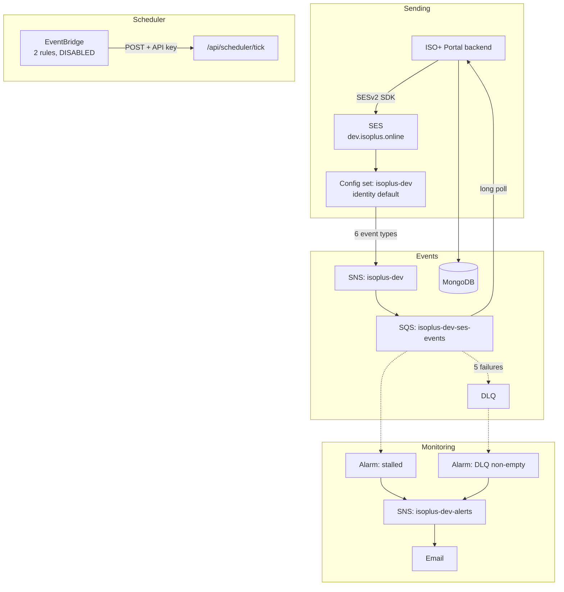

# Automated invoicing and statement delivery: AWS overview (written 17 to 20 August 2026)

Documentation for two related pieces of work: the AWS infrastructure that sends email and captures delivery and bounce events, and the invoice item selection and statement generation that runs on top of it.

**Region:** `ap-southeast-2` (Sydney) · **AWS Account:** `<AWS_ACCOUNT_ID>`
**Written:** 17 to 20 August 2026 · **Environment documented:** dev

---

## Documents

| Document | Audience | Read it when |
|---|---|---|
| [01-developer-guide.md](01-developer-guide.md) | Developers | Writing code that sends email or consumes events |
| [02-terraform-runbook.md](02-terraform-runbook.md) | DevOps | Building UAT or production |
| [03-operations-sop.md](03-operations-sop.md) | Whoever is on call | Something is broken, or an alarm fired |
| [04-invoice-statement-generator.md](04-invoice-statement-generator.md) | Developers, BA | Building invoice item selection or statements |
| [05-document-storage-notes.md](05-document-storage-notes.md) | the product owner | Background only. Not a work item |
| [06-improvements-and-roadmap.md](06-improvements-and-roadmap.md) | Client, the product owner | Out-of-scope items needing approval and budget |
| [infrastructure/iam/](../../infrastructure/iam/) | DevOps | Dev team access policies, applied and verified 20 Aug 2026 |
| [templates/](templates/) | Developers | The statement pdfme template, a rendered sample, and the script that builds it |
| [infrastructure/terraform/](../../infrastructure/terraform/) | DevOps | The infrastructure as code itself |

---

## The system in one diagram

---

## Current state, dev

| Component | Status |
|---|---|
| SES domain identity `dev.isoplus.online` | Verified, DKIM `SUCCESS` |
| Custom MAIL FROM `mail.dev.isoplus.online` | `SUCCESS` |
| Config set `isoplus-dev` | Identity default, TLS required |
| Event destination | 6 event types to SNS |
| SQS pipeline | Working, DLQ empty, raw delivery on |
| CloudWatch alarms | 2, both proven to fire and clear |
| EventBridge rules | Created, **DISABLED** pending API deployment |
| Account sending | Production access, not sandbox |
| Mail Manager | Removed 18 Aug 2026 |
| Outbound archiving | Removed 18 Aug 2026 |

---

## Decisions worth knowing

**SQS rather than an HTTPS webhook.** The original design had SNS posting to `/api/email/events`. SQS replaced it: no public endpoint, no signature verification, no subscription handshake, and 14 days of buffering if the consumer is down. The consumer code is simpler than a secured webhook would have been. **The webhook must not be built.**

**One shared AWS account.** Dev, UAT and production all live in `<AWS_ACCOUNT_ID>`. There is no isolation. The suppression list in particular is account-wide, so a careless dev test can stop production email reaching a client. This shapes most of the safety guidance in these documents.

**A recipient allowlist in dev and UAT, none in production.** Dev credentials can only send to three domains. It is a safety net against emailing real clients from a test, not a security control. Production has no allowlist, because real clients are on arbitrary domains and any list would silently block them.

The list stays at three domains. A request to add a developer's own domain for testing was declined on 18 August 2026: the simulator addresses exercise the identical code path and produce real events, so widening the allowlist would add client-suppression risk for no testing benefit.

**Config set attached as identity default.** The application never passes `ConfigurationSetName`, so it cannot accidentally send an untracked email.

**Dev stays manual, Terraform starts at UAT.** Dev was built by hand and is not imported. Importing hand-built resources produces state that diverges from reality in ways you discover during an outage.

**EventBridge is not yet integrated.** Scheduling already exists via BullMQ and Redis. EventBridge adds a trigger that lives outside the application and a CloudWatch audit trail of every fire, but the tick endpoint enqueues into BullMQ anyway. The rules are disabled and the decision to keep or drop it is open.

**Statements are built on pdfme v5**, matching `@pdfme/generator` 5.5.8 already in the Backend. The transaction list is a dynamic table, which requires a blank `basePdf` and therefore rules out a branded letterhead PDF as the base.

**Two controls prevent double billing, not one.** A unique period key on `invoicenumber` stops a period being invoiced twice; an invoiced marker on each source item stops the same item being claimed by two invoices. Manual invoicing must set the marker too, or automation will re-bill those items.

---

## Open items

| Item | Owner | Notes |
|---|---|---|
| **IMS Job Management conditions** | Business owner | Fifth invoice type is named but its date fields and qualifying statuses are not defined. The only item blocking a complete build. The other four types can be built without it |
| Statement delivery: attachment or link | the product owner | Not a build blocker. See [05-document-storage-notes.md](05-document-storage-notes.md) |
| The original IAM access key (id in the password manager) rotation | the product owner | Created 2025-03-19, previously exposed in cleartext. Deliberately deferred |
| Confirm nothing needed outbound mail archiving | the product owner | Removed 18 Aug 2026. Check against NDIS record-keeping obligations |
| Tell the dev team the webhook is superseded | the product owner | Draft message prepared. They may still be building `/api/email/events` |
| Keep or drop EventBridge | Product owner + dev team | Rules are disabled, so no cost to deciding later |

---

## Verification note

The infrastructure documents were checked against live AWS state using the CLI, not written from memory. Two things believed true at the time turned out to be wrong when checked, and both are corrected here: the Mail Manager archive was not deleted when it was thought to be, and the application access key was never rotated.

The invoice and statement specification was checked against the portal source. The date field mappings in section 2.3 are read from the existing manual invoicing code rather than described from the requirement, so they cannot drift from it.

The statement template was verified by rendering: `templates/statement-sample.pdf` was produced from the template with `@pdfme/generator` 5.5.8, and both reconciliation checks pass.

The Terraform is the exception. It has been written and reviewed but never applied, because Terraform is not installed on the machine it was authored on. Expect small fixes on the first UAT run. That is what UAT is for.
