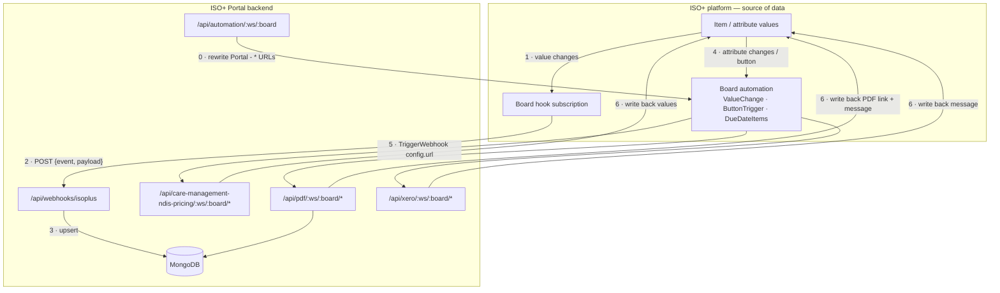

# Webhook and automation contract: document, then test

**Ticket:** KAN-13 (part of the agentic-workspace work)
**Date:** 2026-08-05
**Status:** Draft, pending approval
**Findings this is built on:** [`docs/ongoing/webhooks-and-automation.md`](../ongoing/webhooks-and-automation.md)

## Why this exists

ISO+ is the source of data. The Portal holds a copy and writes results back, but every item, attribute and value originates upstream.

**The teams on the ISO+ side do not have access to this source code.** Webhooks are therefore not one integration option among several — they are the entire contract between the two systems. When someone upstream needs to know what a Portal endpoint expects, what it returns, or which attribute change fires it, there is nothing they can read. Today that knowledge exists only in this repository's source, which is exactly where they cannot look.

Two consequences shape this plan:

1. **The contract has to be written down in a form that is useful without the code** — endpoint, trigger, payload, response, and what the Portal writes back.
2. **The contract has to be enforced by tests**, because the current failure mode is silent. Every one of these endpoints returns HTTP 200 on failure, so a broken integration is invisible from the ISO+ side. A contract nobody can read and nothing verifies will drift.

## End-to-end flow

Three distinct flows. Roles differ, and so do the failure modes.



### Flow A — sync: ISO+ pushes data in

1. A board has sync enabled. The Portal registers **one hook per board** against the ISO+ v2 API, subscribing to eight events and supplying `<BACKEND_URL>/api/webhooks/isoplus` as the callback.
2. ISO+ returns `id` and `secret`; the Portal stores them as `Board.hookId` / `Board.hookSecret`, and the board moves toward `syncStatus: realtime_sync`.
3. Any change upstream delivers `POST {event, payload}`. The eight subscribed events are `item.created`, `item.updated`, `item.deleted`, `item.finalized`, `value.created`, `value.updated`, `comment.created`, `comment.updated`.
4. The Portal dispatches on `event` and upserts into Mongo. **An event outside the eight returns 200 and is silently ignored** — indistinguishable, upstream, from one that was processed.

There is no per-attribute filter: any value change on any attribute of a subscribed board fires `value.updated`.

### Flow B — automation: ISO+ asks the Portal to do work

This is the flow the upstream teams actually configure, and the one they cannot read source for.

1. A user changes a specific attribute on an item, or presses a button attribute.
2. That fires a board automation whose workflow is a trigger node (`ValueChange` carrying `config.attributeId`, or `ButtonTrigger`) wired to a `TriggerWebhook` node carrying `config.url`.
3. The URL is `https://portal-backend.isoplus.online/api/<family>/<workspaceId>/<boardId>/<endpoint>[?type=<type>]`.
4. The Portal validates: `items[]` must be present and non-empty; a `Business` must exist for the workspace.
5. For `participants-service-plan`, it dispatches on `?type=` — **through one of two paths**, selected per request by the item's data.
6. It computes pricing, generates a PDF, or pushes to Xero.
7. It **writes back into the originating item**: an integration message into `Board.attribute.id`, and for PDFs a link into `Board.pdfAttribute.id`. It also records a `PDFLink` and an audit-trail entry.
8. It responds **200 regardless of outcome**. The only real signal is the message written back in step 7.

### Flow C — management: repointing automations after a deploy

`PUT /api/automation/:ws/:board` fetches the board's automations and rewrites `workflow[].config.url` for every automation **named `Portal - …`** so the host matches this deployment's `BACKEND_URL`. The name prefix is the entire selection mechanism. This is how a restored or migrated environment stops calling the wrong backend.

## What is wrong today

From the traversal of board `eNiJpH14PN3` (41 automations, 26 of them `Portal - `):

| # | Problem | Consequence |
|---|---|---|
| 1 | `participants-service-plan` has two dispatch paths accepting **different** `?type=` sets | 4 of 22 automations no-op on new-pricing items; 3 of 22 no-op on legacy items. Always at 200. |
| 2 | Every failure returns HTTP 200 | Upstream cannot detect a broken integration at all |
| 3 | `hookSecret` is stored and never verified | Unauthenticated writes into Mongo by anyone who can reach the host |
| 4 | Callback URL falls back to `http://localhost:3001` when `BACKEND_URL` is unset | Board looks subscribed; deliveries go nowhere |
| 5 | No test runner configured | `npm test --if-present` no-ops in CI; nothing guards any of the above |

Problem 1 is the one to resolve first: it is the only one where correct-looking configuration produces wrong results.

## Steps

Each step is independently reviewable and lands its own commit. Verification is stated per step; a step is not done until its check has been run and its output pasted into the PR.

### 1 · Build a ServicePlan fixture — the seed cannot support this work

**Resolved:** the dispatch rule is decided **per item**, not per board, by `resolveNdisPricingRuleForAutomation` (`utils/ndisPricingRules.js:104`) reading two attributes off the webhook payload:

| Item carries | Rule |
|---|---|
| `Direct Support Item Number` only | `legacy` |
| `Support Item Number` only | `new` |
| Both, new one has a value | `new` |
| Both, new one empty | `legacy` |
| Neither | item lookup → board rule → defaults to `legacy` |

Because it is per item, two ServicePlan items on the same board route differently. The type split is therefore **live by design, not latent** — any new-schema item makes the `direct_support` and `centre_capital_cost` automations return `Invalid type`, and any legacy-schema item does the same to `support`, `labour_travel_time_cost` and `cancellation_cost`.

**What is not known is the volume**, and the seed cannot tell us:

```
board eNiJpH14PN3 present in seed : 1
items on that board                : 0
boards with any items at all       : 1 of 34   (3205 items, all reference data)
items carrying either attribute    : 0
```

So the first piece of work is not an investigation, it is a fixture. Steps 5–7 cannot run without ServicePlan items that carry known attribute combinations.

- Build a fixture board with ServicePlan items covering all five rows of the table above.
- **Verify:** each fixture item resolves to the expected rule via `resolveNdisPricingRuleForAutomation`, asserted directly.
- **Note for sizing:** answering "how many production items are on each schema" needs production data and is a separate question from making the tests runnable. It determines the urgency of the fix, not the shape of it.

### 2 · Pick a test runner

Prerequisite for everything after. `Backend` has no `test` script; CI already calls `npm test --if-present` with `--coverage --coverageReporters=lcov`, which implies Jest-compatible flags.

- **Verify:** `cd Backend && npm test` runs and reports zero failures on an empty suite; CI stays green.

### 3 · Freeze the automation inventory as a fixture

Commit the trimmed `GET /api/<team>/automations/<board>` response — name, `active`, trigger kind, `attributeId`, webhook URL. Ids and URLs only, no customer data.

- **Verify:** the fixture round-trips; a deliberate regeneration produces no diff.
- **Why it earns its place:** a diff in this file means someone changed an automation upstream. That is currently invisible.

### 4 · Route-coverage test

For every URL in the fixture, assert a matching Express route exists.

- **Verify:** passes on all 26; deliberately renaming a route in a scratch branch makes it fail.
- Catches an automation pointed at an endpoint that was renamed or never existed — today a silent 200.

### 5 · Type-dispatch table test

Drive both dispatch functions with all nine live `?type=` values and assert the acceptance matrix. Pure functions, no I/O.

- **Verify:** the matrix in the findings doc is reproduced exactly, including the gaps.
- This is the regression test for whatever fix step 1 justifies.

### 6 · Payload-contract tests

Per family: missing `items[]` → `No items found in the payload`; absent `Business` → `Business not found`; unknown `?type=` → `Invalid type`.

- **Verify:** each asserts the **response body**, never the status code, since everything is 200.

### 7 · Inbound sync-hook tests

Post each of the eight events with a minimal payload; assert each is handled rather than falling through to the ignore branch. Add negatives (`{}`, missing `payload`) for the 400.

- **Verify:** eight handled, two rejected.
- When signature verification lands, this is the file it gets tested in.

### 8 · Publish the contract to `docs/open/`

The deliverable the upstream teams can actually use, written for a reader with no access to this source. One document per endpoint family: URL shape, trigger, request body, `?type=` values with meaning, response bodies, and what gets written back to which attribute. Derived from the tests above so it cannot drift silently.

`docs/open/` is the agreed home — see its [README](../open/README.md). It is separated from the rest of `docs/` precisely so it can be shared outward without shipping internal notes with it.

- **Verify:** someone who has never seen this repository can configure a new automation from the document alone.

### 9 · Flag the legacy types for deprecation — **follow-up PR, not this one**

`direct_support` and `centre_capital_cost` are to be retired. That is a decision, not a discovery, and it changes behaviour, so it does not belong in a documentation-and-tests change.

Scoped for its own ticket and PR:

- Mark both types deprecated in the published contract, with the replacement named.
- Identify the four affected automations on board `eNiJpH14PN3` (2 × `direct_support`, 2 × `centre_capital_cost`).
- Decide the removal order — the automations upstream must stop sending the type before the backend stops accepting it, or the window between the two is a silent outage.

Nothing in steps 1–8 should assume the retirement has happened. The tests in step 5 assert the matrix **as it is today**, including the legacy types; they get updated by that follow-up, which is what makes the change safe.

## Out of scope

- **Retiring the legacy types** — step 9, deliberately a separate PR.
- Fixing the `hookSecret` gap — separate bug ticket; a security change, not documentation.
- Changing the 200-on-failure convention. It is load-bearing for ISO+ retry behaviour and needs an upstream conversation.
- `/api/age-care`, which receives no automation traffic on the board examined.
- Other boards in workspace `55369` — not yet enumerated.

## Questions, resolved

| # | Question | Answer |
|---|---|---|
| 1 | Which dispatch path do production items take? | Decided per item by two attributes. The split is live by design. Volume unknown — the seed has zero ServicePlan items, so step 1 builds a fixture. |
| 2 | Are `direct_support` / `centre_capital_cost` still supported? | To be retired. Flagged for deprecation in step 9, as a **follow-up PR**. |
| 3 | Is the API version skew intentional? | Accepted as possibly intentional. Not treated as a defect; noted in the contract so upstream can correct it if not. |
| 4 | Where does the contract live? | `docs/open/`. |

Still genuinely open: how many production items sit on each pricing schema. That sizes the urgency of the type split but does not block any step here.
