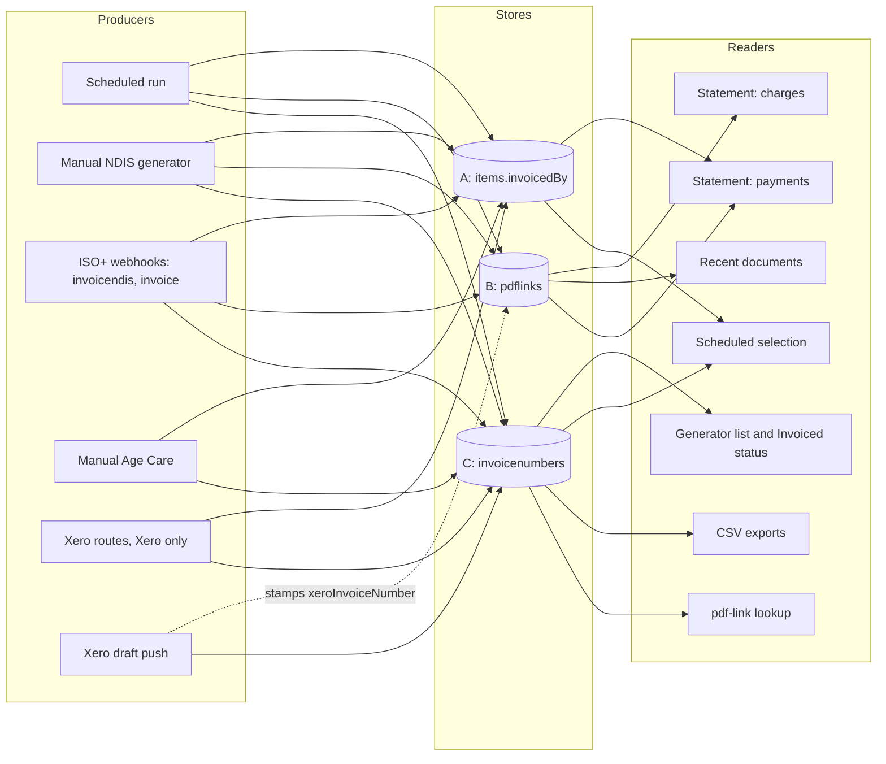
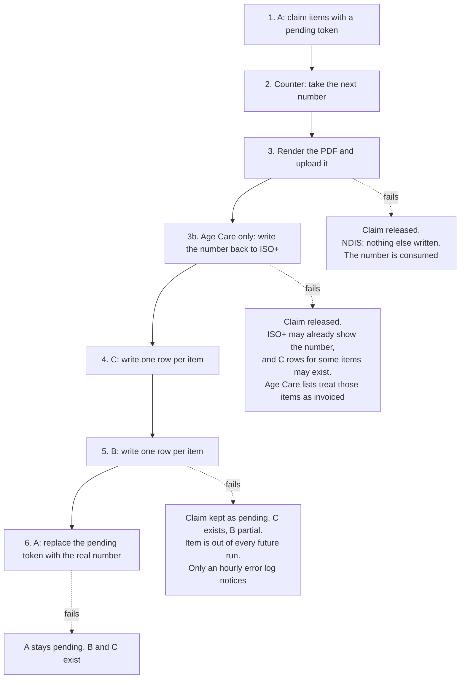
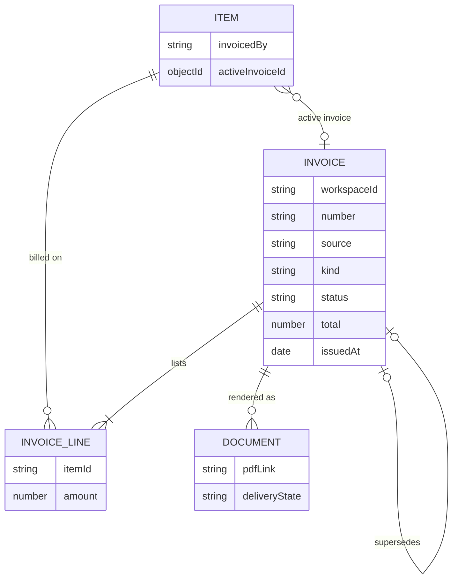
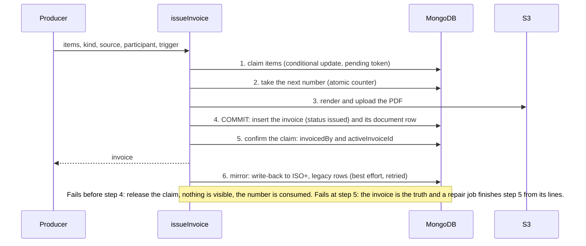
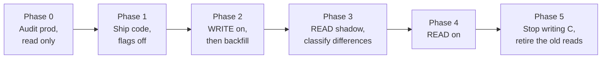

# One source of truth for invoices

**Status:** Accepted for implementation (Masoud, 2026-10-04: "implement the best solution"). Built in the PR series listed in [`docs/ongoing/2026-10-04-invoice-ledger-handover.md`](../../ongoing/2026-10-04-invoice-ledger-handover.md). Decisions D2, D3, D5, D6 and D7 were taken from the recommendations in section 12; D1 and D8 were decided explicitly, D4 stays deferred. Where the implementation departs from this document, a "Changes since approval" section records it.
**Ticket:** KAN-302
**Related:** KAN-296 (statement and generator show different numbers), KAN-297 (a payment dropped from the statement), KAN-287, KAN-289 (re-invoicing, open question), KAN-293, KAN-294, KAN-274 (statement lists every invoice)
**Last updated:** 4 October 2026 (revised after an independent review the same day)

## 1. Summary

An invoice's identity is stored in three places that can disagree, and the code that writes them has no recovery when one step fails. The statement reads some of them, the Invoice Generator reads another, and neither can see an invoice that exists in only one place. That is why the client asked "what is 22, and what is 23?" and why a $100 payment never reached a statement.

The design makes **one invoice record** the truth, with the invoice owning the list of items on it. Every producer (automatic run, manual generator, webhooks, Xero) creates invoices through **one function**, and every screen and document reads them through **one module**. The old stores stay in step during the transition, so rollout is gradual and reversible. Old production data is **prefilled** into the new record by an idempotent, dry-run-first script, with a report of everything it could not place.

Two things need saying plainly, because they are easy to miss:

* **Statements will change at go-live, on purpose.** Invoices that are invisible to the statement today (marker-only invoices, manual Age Care, Xero) will appear as charges, and payments that are dropped today will be applied. Section 6.6 lists exactly what changes and how each change is counted, and decision D3 asks for it to be accepted.
* **The design allows re-invoicing (KAN-289) without deciding it.**

## 2. The problem

### 2.1 The three stores

| | Where | One record is | Written by | Read by |
|---|---|---|---|---|
| **A. Marker** | `items.invoicedBy` (plus `invoicedAt`, `invoicedPeriodKey`) | A text field on one job item. Values: `INV-25`, legacy `INV-24 (ISO+™)`, Xero `INV-0001 (Xero)`, or a temporary `pending:<type>:<periodKey>:<participant>` claim | Every producer, by a conditional update that doubles as the lock against billing an item twice | Scheduled selection, the statement's payment matching |
| **B. Ledger** | `pdflinks` | **One row per item**, not per invoice. The invoice total is repeated on every row, so readers dedupe by `pdfLink`. `type` is free text and the same collection also holds quotes, POs and statements. Older hand-raised rows were written **without** `invoiceNumber`, `participant`, `invoiceTotal` or `boardId` (170 of 175 invoice rows on one dev workspace), and the `/invoice` webhook still writes a type `Invoice` row with no number | Scheduled runs, the manual NDIS generator, the `/invoicendis` and `/invoice` webhooks. The Xero draft push stamps `xeroInvoiceNumber` onto existing rows | The statement's charges, the recent-documents list, replay checks |
| **C. Old log** | `invoicenumbers` | **One row per item per type** (`PDF` or `Xero`), upserted on `{itemId, workspaceId, boardId, type}`. A later number **overwrites** the earlier one, so the log cannot reconstruct earlier invoices. No unique index | Every producer, through `saveInvoiceNumber` | The Invoice Generator lists and "Invoiced" status, CSV exports, the pdf-link lookup |

A fourth, non-authoritative copy exists on the item as `data['Generated Invoice Number']` (synced from ISO+, rewritten wholesale by every sync) and as a text field in ISO+ itself.

### 2.2 How the writers behave today

Two kinds of producer write **no ledger row at all**: the manual Age Care route and the manual Xero-only routes. Those invoices can never reach a statement of account. The Xero **draft push** is different: it pushes an invoice the portal already issued (and already has ledger rows), then stamps `xeroInvoiceNumber` on those rows. Its marker claim is refused because the item already holds the portal number. The `/invoice` webhook writes a ledger row with no invoice number.

### 2.3 Where it breaks

The scheduled run, the most important producer, writes in this order, and each arrow is a place it can stop. Age Care has one extra step, the write-back of the number to ISO+, which can throw:

The manual paths are no better. The manual NDIS generator can create the document and use the number, then fail on the ledger write and tell the user "Failed to generate". The `/invoicendis` webhook writes the ledger row first and answers 200; if the ISO+ write-back then throws, there is a ledger row and **no marker and no log row**.

### 2.4 Who reads what, and the contradictions

| Reader | Reads | Consequence |
|---|---|---|
| Statement charges | B only | Cannot see an invoice with no ledger row (INV-3, INV-6 on dev) |
| Statement payments | A for the number of the invoice a payment is on, B for the list of invoices, joined by exact string | A payment on an invoice B does not list is dropped. Suffix differences (`(ISO+™)`, `(Xero)`) never match |
| Generator list, "Invoiced" status, number shown | C only | Shows a stale number (INV-22). Xero-billed items still look billable. A released claim with a surviving C row looks invoiced |
| Scheduled selection | A (the marker) **and** C: both scheduled paths list items with status `pending`, which drops any item that has a `PDF` log row, and the claim then excludes marked items | Two guards on one path. Neither guard covers an item whose only log row is `Xero` and which has no marker |
| CSV exports | C, with no type filter in one of them | A Xero row and a PDF row can overwrite each other |
| pdf-link lookup | C only, exact number then a retry with the `(ISO+™)` suffix added. Returns `itemId` and the stored number | Resolves through the wrong store |

Observed on dev (workspace 55515): INV-22 exists only as 44 stale log rows; INV-3 and INV-6 (1 and 41 items) exist only as markers. A $100 payment sat on INV-3.

### 2.5 Facts that shape the design

* An invoice holds many items. An item can be invoiced again on purpose (KAN-289), and today a second invoice leaves the marker on the first. The statement then counts both invoices as owed while the payment points at only the first.
* There is no void, reset or re-invoice route anywhere. `PUT /api/pdf-links` soft-deletes a ledger row but nothing in the Frontend calls it and it does not touch the marker.
* The billed total is not the same thing on every kind of invoice. Age Care invoices bill the **participant contribution**, except on Low Cat boards, which bill the full service amount. Anything that recomputes a total must use the generators' own functions.
* The statement is per board and matches on participant name today, and KAN-274 made it list every invoice ever, not one period.
* Migrations never run on deploy; a merge to `develop` or `main` deploys the backend. Local Mongo has no replica set, so there are no multi-document transactions.
* Document numbers are claimed atomically for invoices, statements and statements of account. Quote and PO numbers still use read, increment, save (KAN-291), and before KAN-290 a user could set `nextNumber`, so production can hold different invoices that share a number.
* Only one unique constraint touches any of this today: `automation_period_item_unique` on `pdflinks`, which exists once the pending migration has run.

### 2.6 What production actually holds

Read from an Atlas snapshot of production taken on 2026-10-03 09:53 UTC, opened on a copy (see [`docs/ongoing/2026-10-04-prod-copy-rehearsal.md`](../../ongoing/2026-10-04-prod-copy-rehearsal.md)). This changes the picture, because production runs the code from before the marker and the ledger numbers existed:

| Fact | Value |
|---|---|
| Database and version | `iso-plus`, MongoDB 8.0 (the local dev stack runs 7.0) |
| Items | 517,206. **None has `invoicedBy`** (0), none has `invoicedAt` |
| `pdflinks` | 25 rows (19 `NDIS Invoice`, 1 `Invoice`, 4 `Quote`, 1 `Purchase Order`). **None has an invoice number.** Only the `_id` index exists |
| `invoicenumbers` | 597 rows: 374 `PDF` (31 distinct invoices, all `(ISO+™)` suffixed, all with a `pdfLink`, 352 of their items still exist) and 223 `Xero` (all `(Xero)` suffixed). Dated 2025-12-22 to 2026-09-28 |
| Automation tables | None: no `scheduledjobs`, `automationsettings`, `automationruns`, `emailsends`, `emailevents`, and no `migrations` collection |
| Businesses | 95, all with `documentNumbering`, none with `documentNumberingInitialized` (the KAN-292 backfill will set it on all) |

So in production **the old log is the only record of which invoice an item was billed on.** The marker does not exist yet and the ledger carries no numbers. Three consequences:

1. **A small gap in the guard against billing twice.** Both scheduled paths already skip an item that has a `PDF` log row (they list items with status `pending`, and that status comes from the log), so hand-invoiced items are protected today even without markers. Only an item whose **only** log row is `Xero` looks unbilled to the scheduler. On the copy that is **16 items, all in one workspace, logged 16 June to 2 July 2026, none since 28 August**, and a run only covers the period that has just ended, so the exposure is small. Of the 368 existing logged items, 149 are PDF only, 16 Xero only and 203 have both. **The markers should still be backfilled from the log before automation is enabled**, because this release removes the log filter from selection ("A only", section 5), after which every one of the 368 would be exposed, and because the marker is the one guard that works when the log is not read.
2. **The old log cannot be treated as stale in production.** Rule 7 of section 6.2 ("log rows that match no marker and no ledger group create nothing") is right for dev, where markers exist, and wrong here, where there are none. In production the log is the primary source for the prefill (section 6.2, rule 3).
3. **Statements have nothing to read.** With no invoice numbers on the ledger, the new statement of account would list no old invoices until they are prefilled.
4. **The log is itself lossy.** It keeps one row per item per type, overwritten by the next number, and 446 of its 597 rows were updated more than a minute after they were created. Each row's number is the latest invoice for that item and type, but its `createdAt` belongs to the first. An invoice that was later replaced on all its items cannot be recovered from the log. The prefill reports how many rows were revisited, and `issuedAt` taken from a revisited row is approximate.

## 3. Goals, constraints, non-goals

**Goals**

1. One authoritative record per invoice. Everything else is a pointer to it or a mirror of it.
2. One function creates invoices; one module reads them. No screen or document queries the three stores directly.
3. A failed step leaves nothing half-written, or leaves something a check can find and a job can repair.
4. Old production data is carried over, with anything unplaceable reported rather than guessed.
5. Every existing screen and API keeps its response shape through the transition.
6. Rollout is gradual and reversible, with a comparison step before any reader changes.

**Constraints**: auto-deploy on merge; migrations are deliberate; no transactions locally; billing and statements are customer-visible and legally relevant.

**Non-goals**: deciding the KAN-289 rules; changing the document numbering counters; redesigning statements (the one addition is the "unapplied payments" line, D3); touching ISO+ itself.

## 4. Target design

### 4.1 The model

**`invoices` (new collection), one document per invoice**

| Field | Meaning |
|---|---|
| `workspaceId`, `boardId` | Where it was issued |
| `number` | The plain number, no suffix: `INV-24`, `INV-0001` |
| `source` | `portal` or `xero`. `xero` means an invoice that exists only in Xero (the manual Xero routes). An invoice the portal issued and later pushed to Xero as a draft stays `portal` and carries `xero` below |
| `legacyNumbers` | Every string this invoice has been known by (`INV-24 (ISO+™)`, `INV-0001 (Xero)`), so old links and lookups still resolve and nothing parses a suffix again |
| `kind` | `ndis` or `age_care` (and, for Age Care, whether the board is Low Cat, because that decides what `total` means) |
| `participant` | `{ profileId, name }`. The statement matches on board and name today, so both are kept; the profile id is the grouping key from KAN-293 |
| `lines` | `[{ itemId, amount }]`, the items on this invoice and what each contributed |
| `total`, `issuedAt`, `dueDate` | The billed total **as the document printed it** (participant contribution for non-Low-Cat Age Care), taken from the document at issue |
| `totalDerived` | `true` only on a backfilled invoice whose total was recomputed from its items because no document total exists |
| `periodKey`, `periodStart`, `periodEnd`, `trigger` | Set for automated runs (`trigger: automation`) |
| `status` | `issued` or `void`. There is no `failed`: an attempt that fails before the commit point leaves no invoice at all (section 4.2) |
| `voidedAt`, `voidReason`, `supersededBy` | Empty until KAN-289 decides how re-invoicing works. They exist so that decision needs no schema change |
| `xero` | `{ invoiceNumber, id }` when the invoice has been pushed to Xero as a draft. Set by the draft push; replaces `pdflinks.xeroInvoiceNumber` as the duplicate-draft guard |
| `duplicateNumber` | `true` on a backfilled invoice that shares a number with a different real invoice (section 6.3) |
| `origin` | `live`, or `backfill` with a reason (section 6) |
| `createdAt`, `updatedAt` | |

**Indexes**: unique `{ workspaceId, source, number }` **partial on `duplicateNumber` not true**; multikey `{ workspaceId, 'lines.itemId' }`; `{ workspaceId, boardId, 'participant.name', issuedAt }`; `{ workspaceId, boardId, periodKey }`.

**What happens to A, B and C**

| Store | After |
|---|---|
| **A. `items.invoicedBy`** | **Stays, as a lock and a pointer.** Its atomic conditional update is the only thing that stops two runs billing one item, and a transaction-free system needs it. It gains a sibling `activeInvoiceId` pointing at the invoice. It holds no detail of its own. |
| **B. `pdflinks`** | **Stays, as the document store**: the file, the delivery state and the history pages read it. Its invoice rows gain `invoiceId`. It stops being a source of invoice identity, number or total. |
| **C. `invoicenumbers`** | **Retired.** Dual-written during the transition, then no longer read, then no longer written. Existing rows stay as an archive; stale ones (INV-22) simply stop appearing anywhere. |

### 4.2 One writer: `issueInvoice()`

Every producer except the Xero draft push calls it with the items, kind, source, participant and trigger. It is the existing claim protocol made complete, with the recovery written down.

Rules:

* **Step 4 is the commit point.** Before it, a failure releases the claim and leaves **no invoice** (the number is consumed, a gap, as today). After it, the invoice is the truth; step 5 is retried and, if it still cannot complete, a repair job finishes it from the invoice's `lines`.
* **The ISO+ write-back moves after the commit**, as a retried mirror. Today it can throw in the middle and leave ISO+, the log and the marker disagreeing. After this change it can fail without any effect on the invoice.
* **The claim token is unique per attempt for manual producers.** The token today is `pending:<type>:<periodKey>:<participant>`. A scheduled run keeps it, because replay of a slot relies on it. A manual invoice has no period, so two concurrent manual invoices for one participant would share a token, and the claim accepts its own token, so both would claim the same items and bill them twice. Manual producers add a per-attempt id to the token.
* The unique index on `{ workspaceId, source, number }` makes step 4 idempotent: a retry after a crash cannot create a second invoice for the same number.
* There are no transactions, so the **invariants in section 10** are what make this safe, and they are checked by a test and by a read-only report.
* During the transition `issueInvoice()` also writes the old stores in the order they are written today **only for producers that wrote them before**. It does **not** start writing legacy ledger rows for the manual Age Care or manual Xero-only routes, because that would change statements while the read flag is still off (section 7).
* The Xero draft push is **not** a producer. It calls `invoiceLedger.stampXero(invoiceId, xeroInvoiceNumber)`, which sets `invoice.xero` (and, while both are written, the old `pdflinks.xeroInvoiceNumber`). Routing it through `issueInvoice()` would create a second invoice for the same items.

### 4.3 One reader: `invoiceLedger`

A single module is the only code allowed to read invoice identity. Screens and documents call it; nothing else queries `pdflinks`, `invoicenumbers` or `invoicedBy` for that purpose.

| Function | Used by |
|---|---|
| `byNumber(workspaceId, number)` | pdf-link lookup. Matches `number` or any `legacyNumbers`, so the suffix retry disappears. Returns `itemId` and the stored number as the endpoint does today |
| `activeForItems(workspaceId, itemIds)` | Generator lists (number, PDF, "Invoiced"), CSV exports, master-plan status |
| `forParticipant({ workspaceId, boardId, participant })` | Statement charges. It keeps today's scope exactly: per board, matched by participant name, every invoice (KAN-274). It takes no period; the statement decides what to do with the dates |
| `paymentsFor(workspaceId, invoices)` | Statement payments, matched by item id through the invoice's lines, never by number text |
| `slotInvoices(workspaceId, boardId, periodKey)` | Replay checks for automated runs |
| `stampXero(invoiceId, xeroInvoiceNumber)` | The Xero draft push |
| `audit(workspaceId)` | The invariant report |

During the transition this module **reads the old stores and the new one and compares them** (section 7), and returns the old answer until the comparison has been clean, with every difference classified, for long enough. That is what lets consumers change once.

### 4.4 Payments

A payment recorded on an item belongs to **that item's active invoice**. The statement counts only `issued` invoices, so a replaced invoice stops showing as owed. This quietly settles part of D4 (a payment on a voided invoice moves with the item to its replacement), so D4 lists it. For existing data the active invoice is the one the marker names, which is where payments point today; no payment moves because of the backfill.

### 4.5 Re-invoicing (KAN-289)

The model allows an item to be on more than one invoice over time: each invoice lists its own lines, and `activeInvoiceId` names the current one. What it does **not** decide is the product answer: whether re-invoicing is allowed, whether it is done as void and reissue, and what happens to a payment already recorded against a voided invoice. Those are rules on top of this model (section 12, D4). Until they are decided, nothing in the new code lets a user invoice an already-invoiced item; the generator keeps its current behaviour and the guard from KAN-289 is a separate change.

## 5. Every existing consumer: how it keeps working

API response shapes do not change in any phase, so the Frontend needs no change for this work.

**Writers**

| Producer | Today | After |
|---|---|---|
| Scheduled NDIS and Age Care runs (`generateDocuments.js`, `automationInvoiceClaim.js`) | A, counter, S3, C, B, A | `issueInvoice()`. The claim protocol is kept; the commit point is explicit |
| Manual NDIS generator (`routes/webhook.js`, `ndisInvoiceGeneratorPdf.js`) | counter, S3, A+C, then B in the route | `issueInvoice()`. A failed ledger write can no longer leave a used number and a "Failed" toast |
| `/invoicendis`, `/invoice` webhooks | B first, then A and C after the 200 | `issueInvoice()` |
| Manual Age Care `/invoiceparticipanttax` | A and C, no B | `issueInvoice()`. **Gains an invoice record, so it appears on statements once reads are switched** (D3) |
| Xero-only routes (`routes/xero.js`, `xeroNdisRouteHandlers.js`) | A and C (`type: Xero`), no B | `issueInvoice()` with `source: xero`. **Gains an invoice record** (D3) |
| Xero draft push (`pushDraftInvoicesToXero.js`) | stamps `pdflinks.xeroInvoiceNumber`, writes a C Xero row, its marker claim is refused | `stampXero()` only. Not a producer |
| Dev fixtures (`Backend/scripts/dev-fixture.mjs`, `devFixtureShape.mjs`) | write A, B and C for the KAN-10 and KAN-11 e2e tests | Must also write invoices, or the e2e suites break once reads are switched |

**Readers**

| Consumer | Today | After |
|---|---|---|
| Statement charges (`generateStatementOfAccount.js`, `statementAccountHistory.js`) | B, deduped by `pdfLink`, per board and participant name | `forParticipant()`, same scope |
| Statement payments (`statementLedger.js`) | A joined to B by exact string, unmatched payments dropped | `paymentsFor()`, by item id. Anything still unplaceable is shown as an "unapplied payments" line (D3), never dropped |
| Generator lists and status (`ndisInvoiceGeneratorRouteHelpers.js`, `invoiceGeneratorRouteHelpers.js`, the master-plan helpers) | C | `activeForItems()`. Same JSON: `invoiceNumber`, `fileUrl` |
| Scheduled selection (`invoiceItemSelection.js`, `automationItemSelection.js`, the list filters in `ndisInvoiceGeneratorRouteHelpers.js` and `invoiceGeneratorRouteHelpers.js`) | A and the `PDF` log rows (both paths) | A only. The log guard goes, which is why the markers must be backfilled first (section 2.6) |
| CSV exports | C, one without a type filter | `activeForItems()`. The Xero-overwrites-PDF case goes |
| pdf-link lookup (`routes/items.js`) | C, exact then suffixed | `byNumber()` |
| Recent documents, PDF history pages | B | B, unchanged |
| Xero draft push idempotency | `pdflinks.xeroInvoiceNumber` | `invoice.xero.invoiceNumber`, with the old field kept while both are written |
| Frontend invoice generator, dialogs, statement settings | The API above | No change |

## 6. Prefilling old data

The backfill is a **script** (`Backend/scripts/invoice-backfill.mjs`, with `--dry-run` as the default, `--apply`, and `--undo`), not a migration. The migration runner applies a migration once and has no per-run dry-run or acknowledgement flags, so "run it again, it must create nothing" cannot be shown through it. The only migration is the one that creates the indexes.

It is **additive** (it only creates `invoices` documents, stamps `invoiceId` on ledger rows and sets `activeInvoiceId`), **idempotent** (the unique index and upserts make a second run create nothing), and **dry-run first**.

### 6.1 Inputs

* B rows of the invoice types (`NDIS Invoice`, `Participant Tax Invoice`) **and** the older type `Invoice` rows, including those with no number.
* A markers: every distinct `invoicedBy` that is not a `pending:` token, with the items that carry it, their `invoicedAt` and their totals.
* C rows (type `PDF` and `Xero`). Where markers and the ledger have no numbers (production) this is the **primary** source, not a fallback: it supplies the number, the items, the PDF link and the date.
* `pdflinks.xeroInvoiceNumber`, to know which portal invoices were pushed to Xero.

### 6.2 Rules, in order

1. **A numbered ledger group becomes an invoice.** Group by `{ workspaceId, boardId, invoiceNumber, pdfLink, participant }`. Lines are the group's item ids, `total` is the repeated `invoiceTotal`, `issuedAt` is `invoiceDate` (falling back to `createdAt`), `pdf` from `pdfLink`. `origin: backfill`, reason `ledger`. **A group is never merged with another group that differs in participant, board or items**, even if the number is the same (section 6.3).
2. **A ledger row with no number is placed through the log or not at all.** Join to C by `pdfLink`, then by `itemId`, to find its number, then apply rule 1. A row that cannot be placed is **not turned into an invoice**; it is reported as `unplaceable-ledger-row`. Those rows have no `invoiceTotal` today either, so the statement does not show them now, and they are not introduced by the backfill.
3. **An invoice with no ledger group is built from the marker or the log.**
   * **Marker-only** (INV-3 and INV-6 on dev; manual Age Care and Xero-only invoices that carry a marker): lines are the marked items; `issuedAt` is the earliest `invoicedAt`, then the log row's `createdAt`; `pdf` from the log if it has one. Reason `marker-only`.
   * **Log-only** (the production case, where no item has a marker and the ledger has no numbers): group the `PDF` log rows by `{ workspaceId, number }`; lines are the logged items that still exist; `pdf` is the row's `pdfLink`; `issuedAt` is the earliest row `createdAt` (approximate for a revisited row, section 2.6). Reason `log-only`. `Xero` log rows are handled by rule 5.
   * **The total** of either kind is computed with the generators' own function for that kind (participant contribution for non-Low-Cat Age Care, the full amount otherwise), not a plain sum, and flagged `totalDerived: true`, because neither production's ledger nor a marker holds a document total. A test pins each kind against a real generated invoice. Where the kind or board cannot be determined, the invoice is reported as `unplaceable` and not created.
4. **The number is normalised.** `INV-24 (ISO+™)` becomes `number: INV-24` with the original in `legacyNumbers`. A `(Xero)` marker with no portal ledger group sets `source: xero`.
5. **Xero rows.** A ledger group whose rows carry `xeroInvoiceNumber` (a draft push of an invoice the portal issued) gets `invoice.xero` set, and its C `Xero` row is not a new invoice. In production there are no automation tables, so none of its 223 `Xero` log rows are draft pushes; they are manual Xero creations. For an item with **both** a `PDF` and a `Xero` log row (203 existing items on the copy) the two are **one billing, not two** (decision D8, Masoud, 2026-10-04): the `Xero` number becomes `invoice.xero` on the portal invoice that holds the item, and never a second charge. If one Xero number turns out to cover items on more than one portal invoice, it is attached to each of them and reported as `xero-spans-invoices`. An item with only a `Xero` row (16 on the copy) becomes a `source: xero` invoice. Each case is reported.
6. **`pending:` tokens are not invoices.** They are listed. A fresh one belongs to a live run; a stale one (the hourly check already logs these) needs a person to decide.
7. **C rows that match no marker and no ledger group** (INV-22) create nothing **when the item itself carries a marker for a different number**, because then the marker, not the log row, is what the item was billed on (the dev case). When the item has **no marker**, because it predates markers (the production case), rule 3 applies and the log row is the record. The test is per item, not per workspace, so one new manual invoice in a workspace cannot flip its old invoices from log-only to stale, and once the marker backfill has run, old invoices arrive as `marker-only`. They are listed as `stale-legacy`. C holds only the latest number per item, so it cannot prove an earlier invoice existed. Nothing reads C after cutover, so these disappear from every screen without being deleted.
8. **Stamp `invoiceId`** on every invoice-type ledger row of each created invoice, so invariant 4 holds.
9. **Set `activeInvoiceId`, deterministically.** For each item, the invoice whose normalised number equals the item's marker. If the marker is absent or a `pending:` token, the invoice that lists the item with the latest `issuedAt`. The result does not depend on processing order, and the script sets it explicitly rather than "unless it already has one".

### 6.3 Cases that need an explicit rule

| Case | Rule |
|---|---|
| Two ledger groups share one number and differ in participant, board or items (the allocator race, or a user-set `nextNumber` before KAN-290) | **Both are created, neither merged.** The later one gets `duplicateNumber: true`, so the unique index still holds for the first. Reported as `duplicate-number`. The statement keeps counting both, as today |
| Two ledger groups share one number and are the same invoice (a hand-regenerated PDF) | One invoice. The extra PDF is kept as another document. Reported |
| One item is on two different invoices (the KAN-289 double billing) | **Both invoices are created and both stay `issued`.** The statement keeps counting both, as today. The item's `activeInvoiceId` is the invoice its marker names. Listed as `double-billed` for the business to resolve once the KAN-289 rules exist |
| A marker names an item that sync has since deleted | The invoice is created from the ledger rows only; the missing item is reported |
| An invoice with a ledger row but a marker on none of its items | Created, reason `ledger`. Reported as `marker-missing` |
| A payment on an item | It follows the item's active invoice, which for existing data is the marker's invoice. No payment moves |

### 6.4 The report

Every run, dry or real, prints counts and lists: invoices created by reason, items linked, `pending:` tokens, `stale-legacy` rows, `unplaceable-ledger-row`, `marker-only-unplaceable`, `duplicate-number`, `double-billed`, `marker-missing`, deleted-item references. A real run refuses to start unless each category the dry run found has been acknowledged on the command line (`--ack double-billed=3`), so nothing is accepted by accident.

### 6.5 Rollback of the backfill

`--undo` removes only documents with `origin: backfill`, unsets `activeInvoiceId` on the items it set, and unsets `invoiceId` on the ledger rows it stamped. Live-issued invoices are never touched.

### 6.6 What changes for customers at go-live

The backfill itself changes nothing a customer sees: until the read flag is switched, every reader still answers from the old stores. At the switch, statements change in exactly these ways, and each is counted in advance by the audit and the dry run:

| Change | Why | Counted by |
|---|---|---|
| **Invoices that are invisible today appear as charges** | Marker-only and log-only invoices (INV-3, INV-6 on dev; **all 31 production invoices**), manual Age Care and Xero-only invoices now have an invoice record | `marker-only` and `log-only` counts and totals |
| **Payments that are dropped today are applied** | Their invoice is now listed, so the payment matches | The statement logs already count dropped payments as unmatched |
| **An "unapplied payments" line appears** | A payment that still cannot be placed is shown, not dropped | Dry-run category counts |
| **Due dates and ageing follow the invoice** (added in KAN-309) | The old statement always printed and aged on issue plus fourteen days. The invoice record keeps the due date the schedule (issue plus the business's receivable terms) or the operator set, and the statement uses it. An invoice with a different due date moves between ageing buckets and shows a different Due Date | The `due_date_differs` shadow class |
| Statements for invoices that already agreed do not change | Same board, same participant name, same invoices | The shadow comparison (section 7) |

This is a visible change to customer statements, so D3 asks for it to be accepted, and for a decision on telling clients.

## 7. Rollout: expand, compare, switch, contract

Two environment flags carry it, both off by default, both changeable without a deploy:

* `INVOICE_LEDGER_WRITE`: `issueInvoice()` also writes the new record (`off` | `on`).
* `INVOICE_LEDGER_READ`: `off` serves the old stores; `shadow` serves the old stores **and logs any difference** from the new record; `on` serves the new record.

**While `READ` is `off` or `shadow`, nothing a customer sees changes.** `issueInvoice()` writes the legacy rows only for the producers that wrote them before, so statements stay as they are until phase 4.

| Phase | What happens | Gate to continue | If it goes wrong |
|---|---|---|---|
| 0. Audit | A read-only script reports markers with no ledger row, stale log rows, `pending:` tokens, double-billed items, the log-versus-marker mismatches and the **logged items that carry no marker** (runbook query 6), per workspace. It runs on the production copy first, and on production only on a replica or off-peak | The report is read and the backfill's categories are understood | Nothing changed |
| 1. Ship | The code deploys with both flags off. Behaviour is identical | Existing tests pass; the invariant test is in | Revert the deploy |
| 2. Dual write, then backfill | Backup first. Set `INVOICE_LEDGER_WRITE=on` **first**, outside a scheduled slot (changing a property restarts the environment's processes), then the dry run, the real run and a second run. WRITE comes first so nothing issued during the backfill is missed, and the backfill skips what already exists | The invariants hold for every workspace; counts match the dry run; the second run creates nothing | Set WRITE off; `--undo` |
| 3. Shadow read | Set `INVOICE_LEDGER_READ=shadow`. The old answer is served; each difference is logged with a class | The agreed soak (a full week and a full statement cycle) with **every difference in a known class, class counts matching the audit, and none unclassified** | Set READ off |
| 4. Switch | **Precondition: the markers are backfilled and query 6 is empty.** Set `INVOICE_LEDGER_READ=on`. Watch the first scheduled run and the first statement after it | Statements and generator lists for workspaces whose numbers are known; the expected changes in 6.6 and nothing else | Set it back to `shadow` or `off`. The old stores are still complete because dual write continues |
| 5. Contract | A later release: stop writing the old log, remove the old read paths | Phase 4 stable for a full cycle | Redeploy the previous release. The old log is stale from here on, so this is the point of no easy return |

**The classes a shadow difference may belong to** (anything else fails the gate): newly visible marker-only invoice; newly applied payment; unapplied-payments line; manual Age Care or Xero-only invoice newly on a statement; duplicate-number pair. Each class's count is compared with the audit and the dry run.

**Reversibility.** Phases 0 to 4 are reversible by a flag. One condition: if `WRITE` is turned off after it has been on, invoices issued while it was off exist only in the old stores, so the backfill must be run again before `READ` is turned back on. Only phase 5 is not reversible, which is why it is its own release.

## 8. Rehearsal on a copy of production

Before anything in section 7 touches production, the whole procedure is rehearsed on a **copy of the production database, run locally**. This is a required step, not an optional one. Dev data is small and was damaged in different ways from production, so it cannot show how the migrations, the backfill and the new code behave on the real shapes and volumes.

It also covers the seven migrations already waiting in `develop` (including the unique index that refuses to build if production holds duplicate rows), so it should be done for the next production release whether or not the ledger ships in it.

**What it must prove**

1. Every pending migration runs in order on the copy, with its duration recorded.
2. Each migration's `down` works, **tested on a separate throwaway restore, never on the copy the rest of the rehearsal uses**. Several `down`s delete data (the runbook's migration table lists which), and re-running `up` does not bring it back.
3. The audit report is produced on real data and every category in it is understood.
4. The backfill's dry run matches the audit; the real run is idempotent when repeated; `--undo` restores the starting state.
5. The invariants in section 10 hold after the backfill.
6. With `INVOICE_LEDGER_WRITE=on` and `INVOICE_LEDGER_READ=shadow`, a sample of real workspaces produces statements and generator lists whose only differences are the classes in section 7, with counts matching the audit.
7. Production timings can be estimated (index builds, backfill duration per thousand items).
8. The marker backfill runs on the copy, a second run changes nothing, `--undo` clears only what it set, and runbook query 6 is empty afterwards.

The Backend unit suite and the KAN-10 and KAN-11 e2e suites are **not** run against the copy. The unit suite starts its own in-memory database and replaces the connection string, so it never sees the copy; the e2e suites load fixtures into workspace 55390 and would pollute it. They run as usual on a normal checkout. The rehearsal runs the migrations, the audit, the backfill and read-only comparisons.

**How the copy is handled.** It contains real participant and business data and may contain live credentials, so:

* **Keep the dump outside the repo, not in `seed/`.** `npm run seed` restores the newest `*.gz` in `seed/` into the shared development database with `--drop`, and only restores a database named `isoplus`, so a routine seed could load production data into dev, or silently restore nothing. Restore explicitly with `mongorestore --nsFrom=<production db>.* --nsTo=isoplus-prod-copy.*` into its own database, never the one you develop in.
* **If the copy is an Atlas snapshot download** (a `.tgz` of the raw storage files, not a `mongodump` archive), it is opened with a throwaway `mongod` of a compatible version, started with no network and no published port, on an extracted copy of the files; the data is then dumped from that and restored as above. The `.tgz` stays untouched.
* **Scrub before the backend first starts against the copy.** Offline mode does not cover Xero (neither `xero.js` nor the draft push checks it), so the only protection is that no token exists. The scrub: unset `businesses.xeroTokens`; drop or clear `sessions`; clear `oauthtickets.accessToken` and `xeroconnecttickets`; set `enabled: false` on every `scheduledjobs` row and on every `AutomationSettings`; clear queued delivery state; treat `users` (real emails and password hashes) as sensitive and, where the rehearsal does not need them, replace or remove them. It is a reviewed script in the repo, and its result is **checked** with count queries (no token left, no enabled schedule) before the backend starts.
* The backend runs with `ISOPLUS_OFFLINE=1`, `AUTOMATION_ENABLED` off and the offline email backend, so nothing reaches ISO+, S3 or SES. Local output goes to the outbox directory only.
* No credential found in the data is copied out, logged or used.
* The database is dropped, and the dump and any extracted files deleted, when the rehearsal is signed off.

**Result.** The outcome (timings, report, differences, decisions) is written to a file under `docs/ongoing/` and linked from the runbook, so the production run starts from known numbers.

## 9. Production deployment

The runbook ([`docs/release-runbook.md`](../../release-runbook.md), "Invoice ledger rollout") carries the operational steps: the order, the commands, the checks and the rollback for each phase. It also states what must be true on production first (a backup, the audit report read, `AUTOMATION_ENABLED` off while the backfill runs) and what the first statement and first scheduled run after the switch must show.

## 10. Invariants and tests

The invariants, which the audit script and a test both check:

1. Every non-`pending:` marker, once its suffix is stripped, has an `issued` invoice whose `lines` contain that item. (A double-billed item satisfies this through the invoice its marker names.)
2. Every item with an `activeInvoiceId` points at an invoice that exists and lists the item, and the item's normalised marker equals that invoice's `number`. Items on a `duplicateNumber` invoice, or on both of two double-billed invoices, are **reported**, not failed, until the KAN-289 rules exist.
3. `{ workspaceId, source, number }` is unique among invoices that are not `duplicateNumber`.
4. Every invoice-type `pdflinks` row that carries an invoice number has an `invoiceId` that exists, except rows listed as `unplaceable-ledger-row`.
5. No `pending:` token is older than the stale threshold without an invoice behind it.
6. Every `issued` invoice's `total` equals the sum of its ledger rows' repeated `invoiceTotal` where it has them.

**Tests, in this order** (the repo rule is characterize first, then move):

1. **Characterization of today.** Tests that pin what the statement, generator list, exports and pdf-link lookup return now, for old suffixed numbers, plain numbers, Xero numbers, marker-only invoices, double-billed items, ledger rows with no number and the Xero draft push. They pass against the unmodified code.
2. `issueInvoice()` unit tests for every failure window in section 2.3 and the concurrent-manual-claim case: each must leave either nothing or a repairable state.
3. Backfill tests over fixtures built from the dev shapes **and the production shapes** (log-only invoices, the same items on a `PDF` and a `Xero` row, a `Xero`-only item, ledger rows with no number, overwritten log rows, no markers at all), and from the dev shapes (INV-22, INV-3, INV-6, a double-billed item, two different invoices sharing a number, a Xero invoice, a suffixed number, a ledger row with no number, a non-Low-Cat Age Care marker-only invoice), asserting the report, the totals per kind, idempotency and `--undo`.
4. Shadow-read tests that a difference is logged with its class and the old answer is served.
5. End to end: issue an invoice by each producer, then generate a statement and check the charge, the payment and the generator row agree. The dev fixtures are updated to write invoices first.

## 11. Risks

| Risk | Mitigation |
|---|---|
| Billing and statements are customer-visible, and they change at go-live | Dual write, shadow read with classified differences, a gate and a flag at every step; reads switch last; the changes are listed in 6.6 and need approval (D3) |
| Backfill invents a wrong number, date or total | Derived values only, flagged `marker-only` and `totalDerived`; totals use the generators' own functions; dry run first; a report of every guess |
| Behaviour changes for manual Age Care and Xero invoices (they appear on statements) | A product decision (D3) before code is written |
| Two writers disagreeing during dual write | One function writes both; the audit checks them against each other |
| No transactions | Explicit commit point, release on failure, a repair job, per-attempt claim tokens, invariants |
| The Xero draft push duplicating invoices | It is not a producer; it only stamps `invoice.xero` |
| The rehearsal copy leaks or reaches live systems | Outside the repo, explicit restore, scrub before first start and verified, offline, dropped at sign-off |
| The change is large for a repo that auto-deploys | Flags default off; each phase is its own change; phase 5 is its own release |

## 12. Decisions needed

| | Question | Recommendation |
|---|---|---|
| **D1** | What ships in the release that is blocked on KAN-296 and KAN-297: the whole ledger, or a smaller fix first? | A smaller fix first: the generator shows the item marker, the statement stops dropping payments silently, and the audit runs on production. The ledger follows as its own release, so the prefill is done once, with the full design. See section 13 |
| **D2** | A new `invoices` collection, or extend `pdflinks`? | New. `pdflinks` is one row per item, mixes documents of several types, and the backfill would need a placeholder file link for invoices that have none |
| **D3** | Accept that customer statements change at go-live (section 6.6), including manual Age Care and Xero invoices appearing as charges, dropped payments applying, and an "unapplied payments" line? And decide whether clients are told | Yes, they are real invoices and real payments. It is a visible change, so it needs a decision and a note to users |
| **D4** | KAN-289: is re-invoicing allowed, how, and what happens to a payment on a voided invoice? The model's default is that a payment moves with the item to its replacement | Deferred until after the release. Nothing here decides it beyond that default |
| **D5** | Stale log rows such as INV-22: leave or delete? | Leave. Nothing reads them after cutover |
| **D6** | Double-billed items and duplicate numbers at backfill: keep both, or void one? | Keep both and report, so the numbers do not change at go-live. Resolve with the KAN-289 rules |
| **D8** | The same items on both a `PDF` and a `Xero` log row (203 on the copy, production has no draft pushes): one billing, or two? | **Decided (Masoud, 2026-10-04): one.** The Xero number is attached to the portal invoice and is never a separate charge. A Xero number that spans several portal invoices is reported |
| **D7** | Who has production access to run the audit and the backfill, in what window, and who supplies the production copy for the rehearsal (section 8)? | Needs an owner and a date. The rehearsal comes first |

## 13. What ships when

* **Before any of it is deployed:** the rehearsal on a copy of production (section 8). It covers the seven migrations already waiting in `develop` too.
* **Before automation is enabled for any production workspace:** backfill the item markers from the old log (section 2.6, consequence 1). Without it the first automatic run can bill already-invoiced items again.
* **This release (answers KAN-296 and KAN-297):** the generator shows the item marker instead of the old log; the statement shows an "unapplied payments" line instead of dropping money; the audit script exists and has been run on production by someone with access; any rows it finds are repaired by a one-off, reviewed script with a rollback.
* **Next release:** phases 1 to 4 of section 7 (the ledger, the backfill, shadow read, the switch).
* **The release after:** phase 5, then the KAN-289 rules.

If D1 goes the other way and the ledger ships in this release, the section 7 gates still apply: the soak in phase 3 is the part that cannot be shortened.

## Changes since approval

Where the implementation departed from this document, and why.

* **`duplicateOrdinal`, not `duplicateNumber` (KAN-304).** Sections 4.1 and 6.3 describe a
  `duplicateNumber: true` flag on a backfilled invoice that shares a number with a different
  real one, under a partial unique index. A partial index filter cannot test for an absent
  field, and a default of `false` would be stored on every invoice and take it out of the
  index. The model uses `duplicateOrdinal` (0 for the invoice that owns the number, 1, 2, ...
  for flagged duplicates) and the unique index is on `(workspaceId, source, number,
  duplicateOrdinal)`. Anything that reads "flagged duplicate" reads `duplicateOrdinal > 0`.
* **The claim token (KAN-304).** Section 4.2 says manual producers add a per-attempt id to the
  claim token. `provisionalClaimToken` and `generateUnderClaim` take an optional `attemptId`
  for that, appended after `#`. The deterministic token a scheduled run uses is unchanged.
  Writing the test showed the gap is real: two concurrent attempts with the same
  deterministic token both claim the same items.
* **`issueInvoice()` composes the existing protocol (KAN-304).** It wraps `generateUnderClaim`
  rather than replacing it: the producer's own older writes run as `record`, the invoice is
  committed under the claim, then the marker is rewritten and the items are pointed at the
  invoice. With the write flag off it is exactly the old protocol.
* **A failed commit keeps the claim pending (KAN-304).** Section 4.2 says a failure before
  the commit point releases the claim. That holds when the producer's `produce` fails. When
  the producer's older writes or the commit itself fail, the claim stays pending, as
  `generateUnderClaim` already does for its `record` step: some of the older rows may exist,
  and handing the items back could bill them twice.
* **Repair only takes what is its own (KAN-304).** `repairInvoice` accepts a marker that is
  absent, a form of this invoice's own number for its source, or exactly the claim token
  stored on the invoice (`claimToken`). It never takes another run's pending claim, a
  plain number for a Xero invoice, or anything on a void invoice. The audit's invariants 1
  and 2 compare number and source, not the number alone.
* **The unique index is a precondition (KAN-304).** Mongoose does not build this collection's
  indexes on boot; the migration does. `commitInvoice` refuses to write without the unique
  index, so the migration must run before `INVOICE_LEDGER_WRITE` is switched on. Added to
  the runbook rollout.
* **Manual producers record the invoice after the fact (KAN-306).** Section 5 puts every
  producer behind `issueInvoice()`. The manual NDIS generator, `/invoicendis` and `/invoice`
  generate the document first and claim per item with the real number afterwards
  (`saveInvoiceNumber`), so there is no provisional claim to wrap. They call
  `recordIssuedInvoice()` once their own writes are done. It commits the invoice, stamps
  the ledger rows and points only the items whose marker already names this invoice (an
  item an earlier invoice holds keeps pointing at that one, as invariant 2 requires). It
  never throws: the document is already sent, and a missing record is what the backfill and
  the audit are for. The concurrent double claim on manual producers (case o) is not
  changed by this PR.
* **A third invoice kind, `job` (KAN-306).** The `/invoice` webhook raises a Job Management
  invoice, billed to the client on the job planning item rather than to a participant.
  Without a kind of its own its markers would show up as audit violations.
* **Line amounts come from what the document printed (KAN-306).** The manual NDIS generator
  returns `lineAmounts` computed from the rows it rendered. The scheduled runs still take
  them from the list read before the claim (review of KAN-305 noted the gap; `commitInvoice`
  now warns when the lines do not add up to the total).
* **Producer groups split further (KAN-307).** Section 5's third group is split: the manual
  Age Care route is KAN-307, and the manual Xero routes (five call sites with different line
  builders) and the Xero draft push are a following PR, so each stays reviewable.
* **The Xero producers stamp or record, they do not issue (KAN-308).** The four manual Xero
  producers create the invoice in Xero first, so like the manual PDF producers they call a
  recorder (`recordXeroInvoice`) afterwards rather than `issueInvoice`. The scheduled Xero
  draft push needs no code of its own: it calls the same handlers, which find the portal
  invoice the items are already on and attach the Xero number to it (D8). A Xero invoice
  over items that sit on more than one portal invoice, or on only part of one, is reported
  and not recorded, because recording it would bill the same work twice.
  The live recorder differs from backfill rule 5 on purpose: a Xero number over several
  portal invoices is attached to **none** of them and reported (`xero-spans-invoices`), because
  attaching it to each would present one charge as several. Two more guards from review: a
  Xero invoice over items marked as billed by an invoice the ledger does not hold yet (the
  window between turning the write flag on and running the backfill) records nothing
  (`xero-on-unrecorded-invoice`), or the item would end up on two invoices; and a portal
  invoice that already carries a different Xero number is not overwritten
  (`xero-already-attached`). Items with no marker at all (from before markers existed) are not
  caught by the second guard and are the backfill's job.
* **Readers are split by consumer (KAN-309).** The statement moves first (4a), then generator
  lists, exports and the pdf-link lookup (4b), then the selection guard (4c). The statement
  keeps `buildStatementLedger` unchanged: the invoice record is adapted into the shapes it
  already takes (`utils/invoiceLedger/statementSource.js`), and each payment record takes the
  number of the invoice it is on, so a payment is matched by the record, never by number text.
  Shadow mode builds the statement both ways and logs each difference with a class
  (`utils/invoiceLedger/shadow.js`); due dates are not compared, because the invoice record
  keeps the date the operator set while the old path always derived issue plus fourteen days.
  The printed "unapplied payments" line is not built yet: a payment on a record that is on no
  invoice is still left off and logged, as before.
* **Statement reader hardening from review (KAN-309).** Each payment record carries the record
  id of its invoice and each invoice a `key` (`statementLedger.js` uses `key ?? number`), so two
  invoices that print one number are told apart and each payment lands on its own. An invoice
  whose documents are all deleted is left out, as the old statement does, because deleting a
  document does not void the record; an invoice with no total or issue date is left out and
  reported; job invoices are not statement invoices. The active-invoice fallback now prefers
  the invoice the item's marker names (4.4) over the latest. The shadow comparator groups by
  number as a multiset, compares days in the statement's timezone, and adds the classes
  `duplicate_number` and `due_date_differs` (known) and `closing_differs` (unexpected: the
  closing balance differs with nothing to explain it). Known classes log at info with a
  per-participant summary; unexpected ones warn.
* **The backfill is built as a pure planner first (KAN-310).** `planBackfill` takes the old
  stores as plain data and returns the invoices, the item pointers, the ledger-row stamps, the
  Xero numbers to attach to invoices that already exist, and the report, so a dry run is exactly
  the plan and the real run applies it. Every source (ledger rows, markers, the log, Xero rows)
  adds its items to one registry of drafts keyed by board, source, number and normalised
  participant, so an item joins the invoice another source already described. Departures from
  section 6.2 worth knowing:
  * An invoice with no date (no `invoicedAt` and no log row to take one from) is reported
    `date-unknown`, never dated today; one dated from a log row that was overwritten later is
    marked `issued-at-approximate` and counted.
  * A ledger row with no board takes its item's, because the old routes never stored one. A
    row with no number is placed by the document link, then by the item **only when the item's
    log row does not name a different document**: the log keeps the latest number per item, so
    an older document must not inherit it (rule 2 says "then by itemId"; this narrows it).
  * Log rows and markers **extend** a ledger invoice of the same number, board and participant
    instead of becoming a second invoice (the printed total covers the whole invoice). Two
    participants sharing a number stay two invoices; the earliest owns `duplicateOrdinal` 0.
  * A log row for an item whose **marker** names a different number is `stale-legacy`. An item
    with no marker that another invoice already lists keeps its logged invoice too and is
    reported `double-billed`, because the log holds the item's latest number.
  * A printed total stands when nothing can be derived (the items may be gone): the invoice is
    created with no line amounts and reported `amounts-unknown`. A regenerated document takes
    the latest document's total and reports when totals differ.
  * A document whose ledger rows are all deleted is reported `deleted-document` and suppresses
    that number **on that board**, so the old log cannot bring it back (the statement leaves it
    out too); a marker caught by it is listed as `suppressedMarkers`.
  * An invoice that already exists gets its ledger rows stamped, a Xero number attached
    (`xeroAttachments`) and, when the plan has items it lacks, an `existingMissingItems` report,
    never a second invoice. Pointers also cover the items of recorded invoices, so a resumed run
    completes.
  * A Xero number over several portal invoices is attached to each and reported
    (`xeroSpansInvoices`); a second, different Xero number on one invoice keeps the earliest and
    is reported (`xeroConflicts`). The live recorder attaches a spanning number to none.
